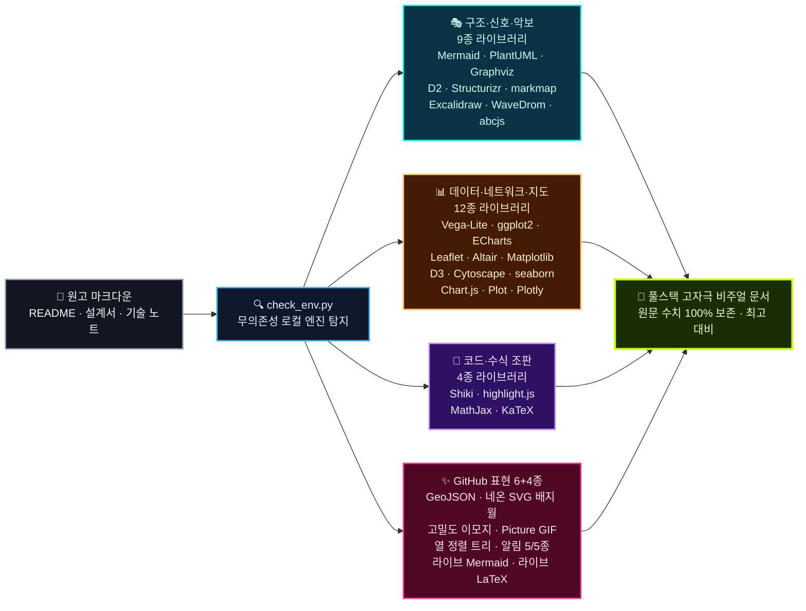
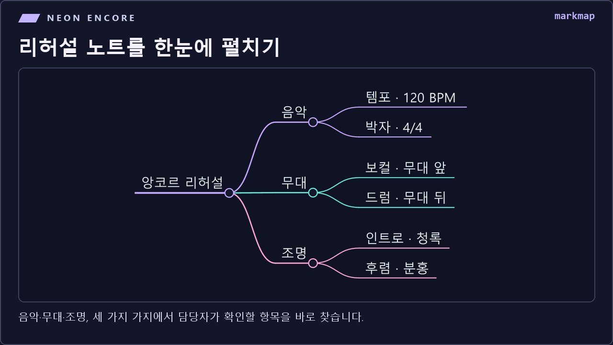
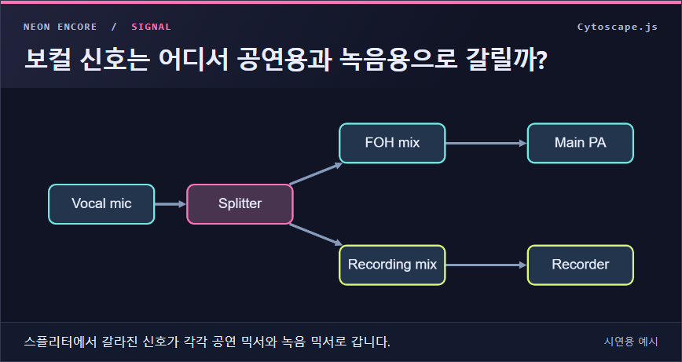
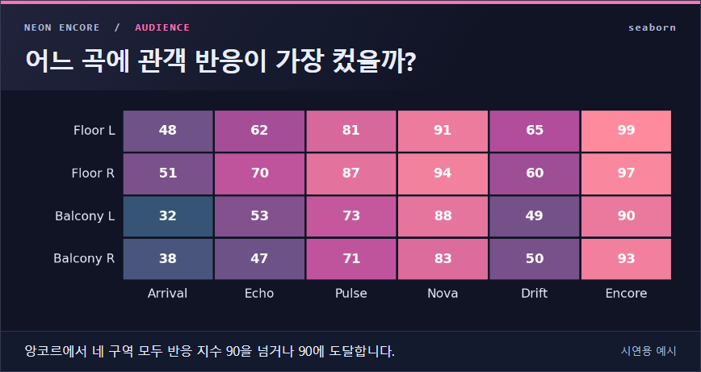
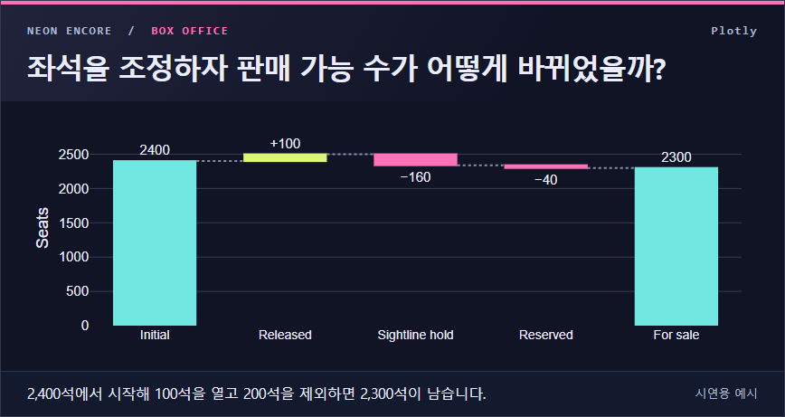

<div align="center">
  <a href="README.md"><strong>🌐 English</strong></a> · <strong>🇰🇷 한국어 (Korean)</strong> · <a href="docs/github-elements.md"><strong>✨ GitHub 표현 6+4종</strong></a> · <a href="plugins/md-viz/skills/md-viz/SKILL.md"><strong>📖 스킬 원문</strong></a>
</div>

<br>

<picture>
  <source media="(prefers-reduced-motion: reduce)" srcset="docs/art/cover.png">
  
</picture>

<h1 align="center">⚡ md-viz · 풀스택 고자극 마크다운 시각화 플러그인</h1>

<div align="center">
  <a href="plugins/md-viz/plugin.json"></a>
  <a href="LICENSE"></a>
  <a href=".github/workflows/ci.yml"></a>
  <a href="#-25종-전체-인라인-시각-갤러리-월"></a>
  <a href="docs/github-elements.md"></a>
  <a href="#-한-줄로-설치하기"></a>
</div>
<div align="center">
  <a href="#antigravity-cli-agy"></a>
  <a href="#claude-code"></a>
  <a href="#codex"></a>
  <a href="plugins/md-viz/skills/md-viz/scripts/check_env.py"></a>
</div>
<div align="center">
  <a href="docs/structure.md"></a>
  <a href="docs/data.md"></a>
  <a href="docs/notation.md"></a>
  <a href="docs/github-elements.md#알림-블록--공연-노트에서-무엇을-강조할까"></a>
</div>
<div align="center">
  <a href="#-라이브-시각화-오버드라이브-파이프라인"></a>
  <a href="docs/structure.md#첫-멜로디--abcjs"></a>
  <a href="docs/data.md#d3--한-박씩-돌려-보면-어떤-조명이-켜질까"></a>
  <a href="#-라이브-인터랙티브-geojson-지도--github-표현-64종"></a>
  <a href="docs/notation.md#다음-큐까지-몇-초를-셀까--katex"></a>
</div>

<p align="center">
  <kbd>/md-viz</kbd> + <kbd>25종 시각화 라이브러리</kbd> + <kbd>GitHub 핵심 표현 6종</kbd> + <kbd>네이티브 부스터 4종</kbd> → <strong>사실 날조 0% · 시각 화력 100%</strong>
</p>

**밋밋한 텍스트 마크다운을 단숨에 시선을 사로잡는 다각도 비주얼 쇼케이스로 바꿉니다.** 리허설 노트에 *“120 BPM, 4/4박자, 첫 마디는 도·레·미·솔”* 이라고 적혀 있으면, `md-viz`는 가용한 모든 렌더러를 동시에 총동원합니다 — 연주자용 오선 악보(**abcjs**), 조명 스위치 타이밍 파형(**WaveDrom**), 32박 원형 시퀀서(**D3**), 관객 동선 생키(**Apache ECharts**), 클릭 가능한 지도(**GeoJSON** + **Leaflet**), 네온 구문 강조(**Shiki** + **highlight.js**), 수식 카드(**KaTeX** + **MathJax** + 라이브 `$$...$$`), 박자 동기화 애니메이션 GIF, 다중 네온 SVG 배지 월, 열 정렬 디렉터리 트리, GitHub 알림 5종까지 **원문 바로 옆에 전면 배치**합니다.

---

## ⚡ 라이브 시각화 오버드라이브 파이프라인

`md-viz`가 `scripts/check_env.py`로 로컬 엔진을 사전 탐지한 뒤 **25종 시각화 라이브러리**와 **6+4종 GitHub 네이티브 기법**으로 전개하는 전체 흐름입니다(GitHub 네이티브 Mermaid + 고대비 네온 `classDef` 라이브 렌더링):



---

## 🎵 여덟 음 → 4중 동시 임팩트

> [!NOTE]
> **NEON ENCORE**는 **25종 시각화 라이브러리**와 **6+4종 GitHub 마크다운 기법** 전부를 하나의 공통 데이터([`examples/data/show.json`](examples/data/show.json))로 실증하기 위해 만든 가상 공연입니다. 아래 모든 악보·파형·차트·지도·수식은 [`examples/`](examples)의 실제 코드로 생성했습니다.

[](examples/data/show.json)

여덟 개의 4분음표(`C D E G | G E D C |]`)를 라이브 GitHub LaTeX 수식과 4종 엔진(**abcjs** · **WaveDrom** · **KaTeX** · **D3**)으로 동시에 해부합니다:

$$\Delta t_{\text{beat}} = \frac{60}{120\text{ BPM}} = 0.5\text{ s}, \qquad T_{8\text{ bars}} = 8 \times 4 \times 0.5\text{ s} = 16\text{ s}$$

| 🎼 첫 멜로디 오선 악보 (`abcjs`) | ⚡ 여덟 박 스위치 파형 (`WaveDrom`) |
|:---:|:---:|
| [](docs/structure.md#첫-멜로디--abcjs) | [](docs/structure.md#박자에-맞춘-스위치--wavedrom) |
| 🧮 **여덟 마디 길이 계산식 (`KaTeX`)** | 🎡 **32박 원형 조명 시퀀서 (`D3`)** |
| [](docs/notation.md#다음-큐까지-몇-초를-셀까--katex) | [](docs/data.md#d3--한-박씩-돌려-보면-어떤-조명이-켜질까) |

### 🎬 박자 동기화 루프 애니메이션 (`<picture>` 동작 줄이기 대응)

<picture>
  <source media="(prefers-reduced-motion: reduce)" srcset="docs/art/cue-player.png">
  
</picture>

밝은 칸이 켜질 박입니다. 세로로 읽으면 같은 순간에 점등되는 조명이 한눈에 들어오며, OS의 `prefers-reduced-motion: reduce` 설정에서는 동일 치수 정지 화면 [`cue-player.png`](docs/art/cue-player.png)이 자동 표시됩니다.

---

## 🔥 25종 전체 인라인 시각 갤러리 월


**25종 시각화 라이브러리 전부의 실제 렌더링 결과**를 페이지 이동 없이 아래에서 한눈에 확인하세요. 각 카드를 누르면 상세 해설과 입력 원본으로 바로 이동합니다.

<details open>
<summary><strong>🎭 1관 · 구조·아키텍처·신호·악보 — 9/9종 전체</strong></summary>

| 🔀 Mermaid · 시작 판단 | 💬 PlantUML · 호출과 응답 | 🕸️ Graphviz · 소리 갈림길 |
|:---:|:---:|:---:|
| [](docs/structure.md#시작-판단--mermaid)<br>[해설](docs/structure.md#시작-판단--mermaid) · [`.mmd`](examples/structure/cue-gate.mmd) | [](docs/structure.md#호출과-응답--plantuml)<br>[해설](docs/structure.md#호출과-응답--plantuml) · [`.puml`](examples/structure/standby.puml) | [](docs/structure.md#소리의-갈림길--graphviz)<br>[해설](docs/structure.md#소리의-갈림길--graphviz) · [`.dot`](examples/structure/signal-path.dot) |
| 🧩 **D2 · 장비 랙 배치** | 🏛️ **Structurizr · C4 경계** | 🌿 **markmap · 리허설 가지** |
| [](docs/structure.md#장비의-위치--d2)<br>[해설](docs/structure.md#장비의-위치--d2) · [`.d2`](examples/structure/patch-bays.d2) | [](docs/structure.md#시스템의-경계--structurizr)<br>[해설](docs/structure.md#시스템의-경계--structurizr) · [`.dsl`](examples/structure/cue-desk.dsl) | [](docs/structure.md#노트의-가지--markmap)<br>[해설](docs/structure.md#노트의-가지--markmap) · [`.md`](examples/structure/set-notes.md) |
| ✏️ **Excalidraw · 무대 평면도** | 📡 **WaveDrom · 8박 파형** | 🎼 **abcjs · 첫 멜로디 악보** |
| [](docs/structure.md#관객이-보는-무대--excalidraw)<br>[해설](docs/structure.md#관객이-보는-무대--excalidraw) · [`.js`](examples/structure/stage-plot.js) | [](docs/structure.md#박자에-맞춘-스위치--wavedrom)<br>[해설](docs/structure.md#박자에-맞춘-스위치--wavedrom) · [`.json`](examples/structure/count-in.json) | [](docs/structure.md#첫-멜로디--abcjs)<br>[해설](docs/structure.md#첫-멜로디--abcjs) · [`.abc`](examples/structure/encore.abc) |

</details>

<details open>
<summary><strong>📊 2관 · 데이터·통계·네트워크·지리 지도 — 12/12종 전체</strong></summary>

| 📈 Vega-Lite · 입장객 누적 | 📦 ggplot2 · 대기 상자그림 | 🌊 Apache ECharts · 동선 생키 |
|:---:|:---:|:---:|
| [](docs/data.md#vega-lite--언제-입장객이-몰렸을까)<br>[해설](docs/data.md#vega-lite--언제-입장객이-몰렸을까) | [](docs/data.md#ggplot2--입구별로-관객은-얼마나-기다렸을까)<br>[해설](docs/data.md#ggplot2--입구별로-관객은-얼마나-기다렸을까) | [](docs/data.md#apache-echarts--세-입구를-통과한-사람들은-어디로-갔을까)<br>[해설](docs/data.md#apache-echarts--세-입구를-통과한-사람들은-어디로-갔을까) |
| 🧭 **Leaflet · 셔틀 좌표 지도** | 🏋️ **Altair · 사운드체크 덤벨** | 🎯 **Matplotlib · 조명 극좌표** |
| [](docs/data.md#leaflet--집결점에서-무대까지-어느-방향으로-움직일까)<br>[해설](docs/data.md#leaflet--집결점에서-무대까지-어느-방향으로-움직일까) | [](docs/data.md#altair--사운드체크-계획은-어디서-어긋났을까)<br>[해설](docs/data.md#altair--사운드체크-계획은-어디서-어긋났을까) | [](docs/data.md#matplotlib--두-조명의-밝은-방향은-어디일까)<br>[해설](docs/data.md#matplotlib--두-조명의-밝은-방향은-어디일까) |
| 🎡 **D3 · 원형 조명 시퀀서** | 🧬 **Cytoscape.js · 신호 연결망** | 🔥 **seaborn · 객석 반응 히트맵** |
| [](docs/data.md#d3--한-박씩-돌려-보면-어떤-조명이-켜질까)<br>[해설](docs/data.md#d3--한-박씩-돌려-보면-어떤-조명이-켜질까) | [](docs/data.md#cytoscapejs--보컬-소리가-녹음기까지-가는-길은)<br>[해설](docs/data.md#cytoscapejs--보컬-소리가-녹음기까지-가는-길은) | [](docs/data.md#seaborn--어느-곡에서-객석-전체가-함께-반응했을까)<br>[해설](docs/data.md#seaborn--어느-곡에서-객석-전체가-함께-반응했을까) |
| 🍩 **Chart.js · 전력량 도넛** | 🏆 **Observable Plot · 기념품 순위** | 💧 **Plotly · 좌석 증감 폭포** |
| [](docs/data.md#chartjs--무엇이-전기를-가장-많이-썼을까)<br>[해설](docs/data.md#chartjs--무엇이-전기를-가장-많이-썼을까) | [](docs/data.md#observable-plot--가장-잘-팔린-기념품은)<br>[해설](docs/data.md#observable-plot--가장-잘-팔린-기념품은) | [](docs/data.md#plotly--좌석-증감이-최종-판매-수를-어떻게-바꿨을까)<br>[해설](docs/data.md#plotly--좌석-증감이-최종-판매-수를-어떻게-바꿨을까) |

</details>

<details open>
<summary><strong>🧮 3관 · 코드 구문 강조·수식 조판 — 4/4종 전체</strong></summary>

| 💎 Shiki · 정적 구문 강조 | 🔦 highlight.js · 동적 구문 강조 |
|:---:|:---:|
| [](docs/notation.md#첫-조명은-무슨-색일까--shiki)<br>[해설](docs/notation.md#첫-조명은-무슨-색일까--shiki) | [](docs/notation.md#어느-박에서-조명을-바꿀까--highlightjs)<br>[해설](docs/notation.md#어느-박에서-조명을-바꿀까--highlightjs) |
| 📐 **MathJax · 정밀 TeX 수식** | ⚡ **KaTeX · 초고속 수식 조판** |
| [](docs/notation.md#한-박의-길이는--mathjax)<br>[해설](docs/notation.md#한-박의-길이는--mathjax) | [](docs/notation.md#다음-큐까지-몇-초를-셀까--katex)<br>[해설](docs/notation.md#다음-큐까지-몇-초를-셀까--katex) |

</details>

> [!CAUTION]
> 데이터 도감을 다시 그리면 기본 경로 `docs/art/data/`의 기존 PNG가 덮어써집니다. 원본과 비교하려면 [`examples/data/`](examples/data/README.md#출력)에서 `python render.py --output preview`로 별도 폴더에 저장하세요.

---

## 🗺️ 라이브 인터랙티브 GeoJSON 지도 & GitHub 표현 6+4종

아래 `geojson` 블록은 GitHub에서 확대·클릭 가능한 **실시간 지도**로 바로 렌더링됩니다([`docs/art/elements/shuttle.geojson`](docs/art/elements/shuttle.geojson) · [`examples/data/show.json`](examples/data/show.json)과 100% 일치):

```geojson
{
  "type": "FeatureCollection",
  "features": [
    {
      "type": "Feature",
      "properties": {"title": "A · 집결", "marker-color": "#27aaa6"},
      "geometry": {"type": "Point", "coordinates": [126.9754, 37.5741]}
    },
    {
      "type": "Feature",
      "properties": {"title": "B · 환승", "marker-color": "#d33b90"},
      "geometry": {"type": "Point", "coordinates": [126.9836, 37.5708]}
    },
    {
      "type": "Feature",
      "properties": {"title": "C · 무대", "marker-color": "#799326"},
      "geometry": {"type": "Point", "coordinates": [126.9774, 37.5662]}
    },
    {
      "type": "Feature",
      "properties": {"title": "방문 순서 A → B → C", "stroke": "#228582"},
      "geometry": {
        "type": "LineString",
        "coordinates": [[126.9754, 37.5741], [126.9836, 37.5708], [126.9774, 37.5662]]
      }
    }
  ]
}
```

> [!WARNING]
> GeoJSON 좌표는 반드시 **`[경도, 위도]`** 순서로 입력하세요. 서울 예제의 첫 경도 `126.9754`를 위도 자리에 넣으면 유효 범위(`±90`)를 벗어납니다. 검증된 좌표 원본은 [`docs/art/elements/shuttle.geojson`](docs/art/elements/shuttle.geojson)에서 확인할 수 있습니다.

여섯 가지 기본 표현과 네 가지 네이티브 부스터의 복사 가능한 완성 문법은 [**✨ 공연 안내서 예제**](docs/github-elements.md)와 [**📐 고자극 표현 패턴집**](plugins/md-viz/skills/md-viz/references/markdown-patterns.md)에 있습니다.

---

## 🔌 한 줄로 설치하기

세 환경 모두 **동일한 단일 소스 플러그인**(`plugins/md-viz/`, MIT)을 설치하며, `SKILL.md` · `markdown-patterns.md` · `scripts/badge.py` · `scripts/check_env.py`가 함께 포함됩니다.

### Antigravity CLI (`agy`)

```sh
agy plugin install https://github.com/Technoetic/md-viz/tree/main/plugins/md-viz
```

> <kbd>/md-viz</kbd> `README.md를 가용한 모든 라이브러리(25종)와 GitHub 표현 기법으로 가장 강렬하게 시각화해 줘.`

### Claude Code

```sh
claude plugin marketplace add Technoetic/md-viz
claude plugin install md-viz@technoetic-md-viz
```

> <kbd>/md-viz:md-viz</kbd> `이 설계 문서의 구조·지표·신호 흐름을 최고 대비의 멀티컬럼 비주얼 쇼케이스로 바꿔 줘.`

### Codex

```sh
codex plugin marketplace add Technoetic/md-viz
codex plugin add md-viz@technoetic-md-viz
```

> <kbd>$md-viz:md-viz</kbd> `README.md의 모든 표·흐름·수식을 25종 렌더러와 GitHub 표현으로 총동원해 시각화하고 실사용 집계를 알려 줘.`

### 🔍 로컬 렌더러 사전 점검 (무의존성)

```sh
python plugins/md-viz/skills/md-viz/scripts/check_env.py
```

> [!IMPORTANT]
> 플러그인은 시각화 지침과 표준 라이브러리 전용 도구 2종(`badge.py`·`check_env.py`)을 설치합니다. 새 그림을 직접 렌더링할 때는 선택한 외부 렌더러도 로컬에 준비하세요. 이 저장소의 완성된 그림은 GitHub와 오프라인에서 바로 볼 수 있습니다. [`examples/data/README.md`](examples/data/README.md#준비)

> [!TIP]
> 기본 호출은 **25종 + 6+4종 풀스택 최대 화력**으로 작동하지만, *"Mermaid 흐름도 한 장만"* 또는 *"`badge.py`로 네온 배지 하나만"* 처럼 한 기법만 지정해도 즉시 따릅니다.

---

## 🗂️ 저장소 구조

```text
md-viz/                         ← 저장소 루트 (MIT)
├── LICENSE                     ← MIT 오픈소스 라이선스
├── SECURITY.md                 ← 보안 정책과 책임 경계
├── README.md                   ← 영문 풀스택 쇼케이스
├── .github/                    ← 자동화 워크플로
│   └── workflows/              ← GitHub Actions 정의
│       └── ci.yml              ← Ubuntu + Windows CI 검증
├── plugins/md-viz/             ← 설치되는 3호스트 슬림 플러그인
│   ├── plugin.json             ← Antigravity 설치 명세 (v0.3.0)
│   ├── LICENSE                 ← 동봉된 MIT 라이선스
│   ├── README.md               ← 플러그인 자체 빠른 안내
│   └── skills/md-viz/          ← 공용 스킬·패턴·도구
│       ├── SKILL.md            ← 풀스택 고자극 시각화 지침
│       └── scripts/            ← 무의존성 표준 라이브러리 도구
│           ├── badge.py        ← 28px 2톤 네온 SVG 배지 생성
│           └── check_env.py    ← 25종 로컬 렌더러 사전 탐지
├── docs/                       ← 25종 도감과 라이브 아트
│   ├── github-elements.md      ← GitHub 표현 6종 실전 안내서
│   └── art/                    ← PNG·GIF·SVG·GeoJSON 결과물
├── examples/                   ← 재현 가능한 입력과 생성 코드
│   ├── badges.py               ← 전체 20종 SVG 배지 재생성
│   └── data/                   ← 공연 JSON과 12종 차트 파이프라인
├── tools/                      ← 릴리스 패키징 도구
│   └── build_release_zip.py    ← 결정적 UTC 슬림 ZIP 빌더
└── tests/                      ← 도감·배지·플러그인 자동 시험
```

저장소 루트에서 `python examples/badges.py`로 20종 SVG 배지 전부를 바이트 동일하게 재생성하고, `python tools/build_release_zip.py --version v0.3.0 --out dist`로 결정적 슬림 플러그인 ZIP과 `SHA256SUMS.txt`를 빌드할 수 있습니다.
