<div align="center">
  <a href="README.md"><strong>🌐 English</strong></a> · <strong>🇰🇷 한국어 (Korean)</strong> · <a href="docs/github-elements.md"><strong>✨ GitHub 안내서</strong></a> · <a href="plugins/md-viz/skills/md-viz/SKILL.md"><strong>📖 스킬 원문</strong></a>
</div>

<br>

<p align="center">
  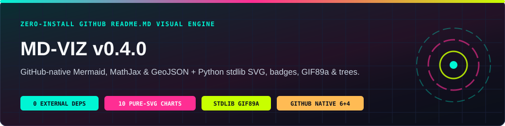
</p>

<h1 align="center">⚡ md-viz · 무설치 GitHub README.md 전용 시각화 엔진</h1>

<div align="center">
  <a href="plugins/md-viz/plugin.json"></a>
  <a href="LICENSE"></a>
  <a href=".github/workflows/ci.yml"></a>
  <a href="#-무설치-순수-svg--gif-시각-갤러리-월"></a>
  <a href="docs/github-elements.md"></a>
  <a href="#-한-줄로-설치하기"></a>
</div>
<div align="center">
  <a href="#antigravity-cli-agy"></a>
  <a href="#claude-code"></a>
  <a href="#codex"></a>
  <a href="plugins/md-viz/skills/md-viz/scripts/check_env.py"></a>
</div>
<div align="center">
  <a href="#-라이브-무설치-아키텍처"></a>
  <a href="plugins/md-viz/skills/md-viz/scripts/svg_chart.py"></a>
  <a href="plugins/md-viz/skills/md-viz/scripts/gif_anim.py"></a>
  <a href="#-라이브-인터랙티브-geojson-지도--github-네이티브-레이어"></a>
  <a href="#-라이브-mathjax-수식--무설치-루프-애니메이션"></a>
  <a href="docs/github-elements.md#알림-블록--공연-노트에서-무엇을-강조할까"></a>
</div>

<p align="center">
  <kbd>/md-viz</kbd> + <kbd>외부 설치 0개</kbd> + <kbd>GitHub 네이티브 (Mermaid · MathJax · GeoJSON · 알림 5종)</kbd> + <kbd>Python stdlib (SVG 10종 · 배지 · GIF89a · 트리)</kbd>
</p>

**외부 라이브러리 설치 없이 GitHub `README.md`를 단숨에 고자극 쇼케이스로 바꾸는 전용 엔진입니다.** GitHub은 `README.md`에서 `<script>`와 외부 JS/CSS를 차단하므로 실제로 직접 돌아가는 라이브러리는 **Mermaid**와 **MathJax**(및 `GeoJSON` 지도)뿐입니다. `md-viz v0.4.0`은 이 제약을 정면 돌파해 GitHub 네이티브 기능 전부와 **Python 3 표준 라이브러리 전용 생성기 4종**(`badge.py` · `svg_chart.py` · `gif_anim.py` · `tree_gen.py`)을 하나로 묶었습니다 — **`npm install` 0개, `pip install` 0개, Pillow·브라우저 불필요**로 모든 PC에서 `/md-viz` 한 번에 100% 동작합니다.

---

## ⚡ 라이브 무설치 아키텍처

GitHub 내장 Mermaid 엔진으로 실시간 렌더링되는 전체 구조입니다(다크-네온 `classDef` 적용):

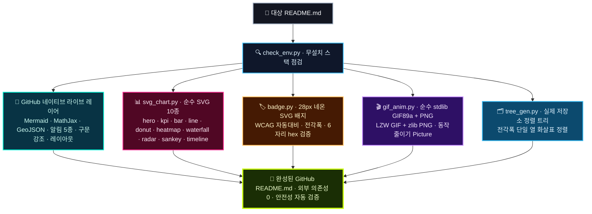

| 구성 요소 | 동작 방식 | 외부 설치 | GitHub `README.md` 렌더링 |
|---|---|:---:|---|
| **Mermaid** | ` ```mermaid ` 블록 | **0** | ✅ GitHub 네이티브 라이브 SVG |
| **MathJax** | `$...$` / `$$...$$` / ` ```math ` | **0** | ✅ GitHub 네이티브 라이브 수식 |
| **GeoJSON / TopoJSON** | ` ```geojson ` / ` ```topojson ` | **0** | ✅ GitHub 네이티브 인터랙티브 지도 |
| **알림 · 구문강조 · 레이아웃** | `[!NOTE]`..`[!CAUTION]` · `<details>` · `<kbd>` | **0** | ✅ GitHub 네이티브 마크다운 |
| **`svg_chart.py` (10종)** | Python 3 stdlib → 순수 `<svg>` | **0** | ✅ GitHub `` 안전 벡터(`<script>`·`<foreignObject>` 0) |
| **`badge.py`** | Python 3 stdlib → 28 px `<svg>` | **0** | ✅ GitHub `` 안전 네온 배지 |
| **`gif_anim.py`** | Python 3 stdlib → LZW `.gif` + zlib `.png` | **0** | ✅ `<picture>` 루프 + `prefers-reduced-motion` 정지화 |
| **`tree_gen.py`** | Python 3 stdlib → ` ```text ` 트리 | **0** | ✅ 실제 디스크 경로 + 단일 열 `←` 정렬 |

---

## 🔥 무설치 순수 SVG & GIF 시각 갤러리 월

> [!NOTE]
> 아래 10종 순수 SVG 차트와 애니메이션 GIF/PNG는 모두 **Python 3 표준 라이브러리만** 사용해 [`examples/data/show.json`](examples/data/show.json)(가상 공연 **NEON ENCORE** 시연용 예시)에서 [`examples/zero_install_showcase.py`](examples/zero_install_showcase.py)로 직접 생성했습니다 — `matplotlib`·`Node.js`·`Pillow`가 전혀 필요 없습니다.

[](examples/data/show.json)

<details open>
<summary><strong>📊 순수 SVG 시각화 10/10종 전체 (<code>scripts/svg_chart.py</code> · 외부 설치 0개)</strong></summary>

| 🧭 `kpi` · 핵심 지표 스트립 | 📊 `bar` · 순위 비교 막대 | 📈 `line` · 다중 시계열 영역 |
|:---:|:---:|:---:|
| 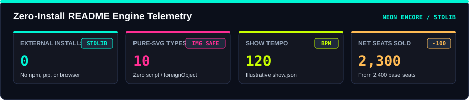 | 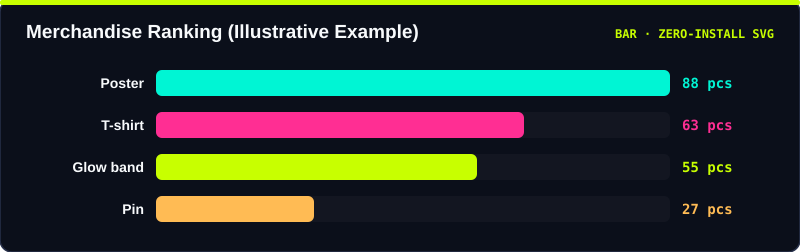 | 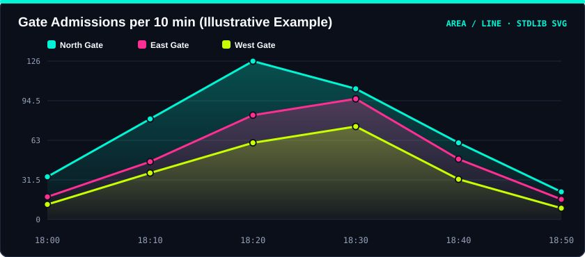 |
| 🍩 **`donut` · 구성비 도넛 링** | 🔥 **`heatmap` · 반응 강도 매트릭스** | 💧 **`waterfall` · 좌석 증감 폭포** |
| 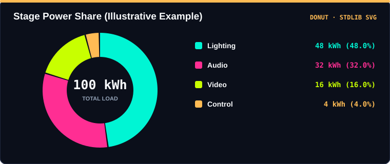 | 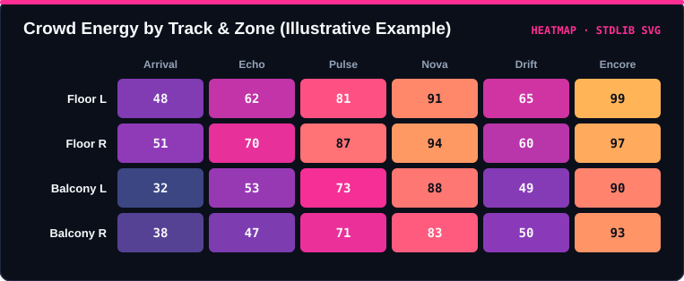 | 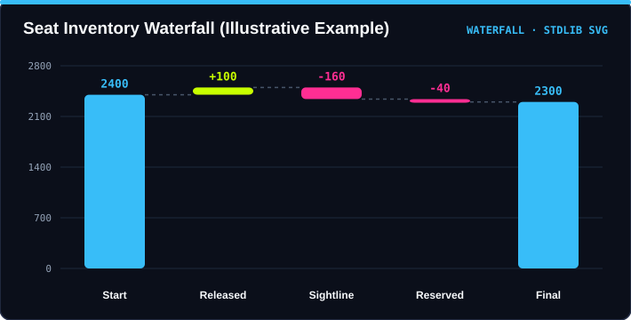 |
| 🎯 **`radar` · 조명 각도 레이더** | 🌊 **`sankey` · 관객 동선 생키** | 🎛️ **`timeline` · 32박 큐 매트릭스** |
| 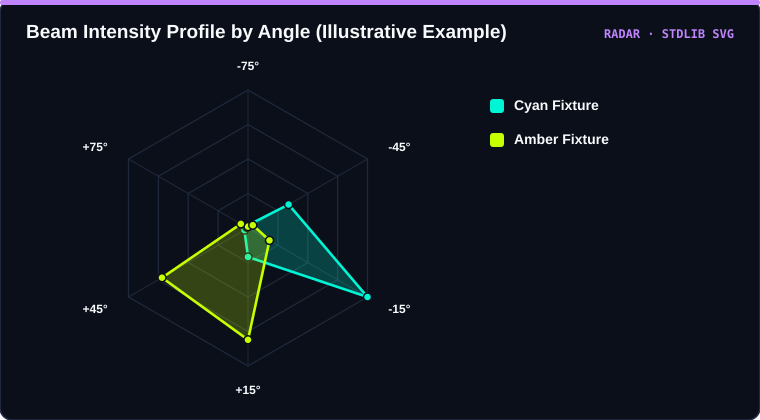 | 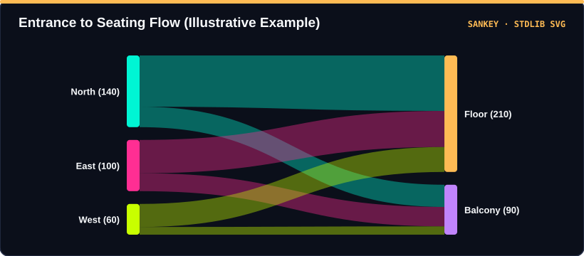 | 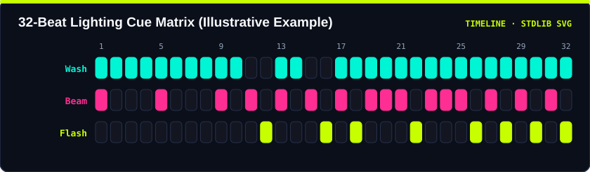 |

*(10번째 유형 `hero`는 이 문서 최상단의 히어로 배너입니다.)*

</details>

> [!CAUTION]
> `python examples/zero_install_showcase.py`를 실행하면 `docs/art/zero-install/`의 기존 추적 SVG/GIF/PNG가 덮어써집니다. 별도 실험 시에는 `python plugins/md-viz/skills/md-viz/scripts/svg_chart.py --out preview/chart.svg`처럼 분리 경로를 지정하세요.

---

## 🎬 라이브 MathJax 수식 & 무설치 루프 애니메이션

GitHub `README.md`는 공식 **MathJax** 엔진으로 LaTeX 수식을 즉시 렌더링합니다:

$$\Delta t_{\text{beat}} = \frac{60}{120\text{ BPM}} = 0.5\text{ s}, \qquad T_{8\text{ bars}} = 8 \times 4 \times 0.5\text{ s} = 16\text{ s}$$

그리고 [`scripts/gif_anim.py`](plugins/md-viz/skills/md-viz/scripts/gif_anim.py)는 Pillow 없이 Python 표준 라이브러리(`struct`·`zlib`·LZW)만으로 **루프 GIF89a + 동일 해상도 정지 PNG**를 생성합니다:

<picture>
  <source media="(prefers-reduced-motion: reduce)" srcset="docs/art/zero-install/cue-loop.png">
  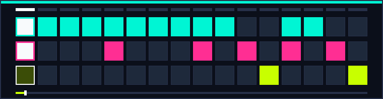
</picture>

<picture>
  <source media="(prefers-reduced-motion: reduce)" srcset="docs/art/cue-player.png">
  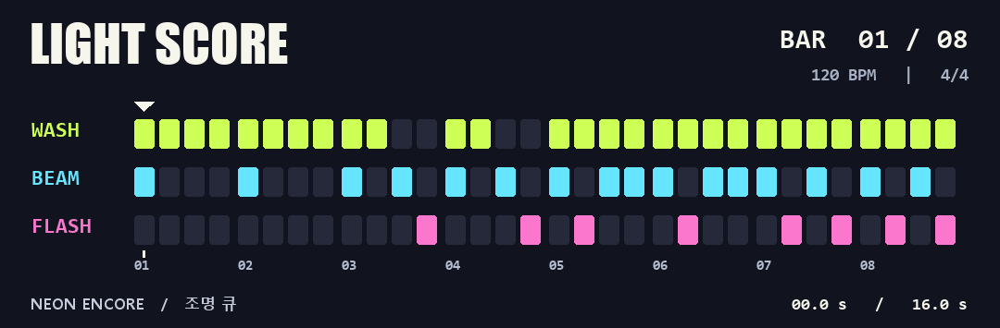
</picture>

---

## 🌍 라이브 인터랙티브 GeoJSON 지도 & GitHub 네이티브 레이어

아래 `geojson` 블록은 GitHub에서 확대·클릭 가능한 **실시간 벡터 지도**로 바로 렌더링됩니다([`docs/art/elements/shuttle.geojson`](docs/art/elements/shuttle.geojson)과 100% 일치):

```geojson
{
  "type": "FeatureCollection",
  "features": [
    {
      "type": "Feature",
      "properties": {"title": "A · 집결", "marker-color": "#27aaa6"},
      "geometry": {"type": "Point", "coordinates": [126.9754, 37.5741]}
    },
    {
      "type": "Feature",
      "properties": {"title": "B · 환승", "marker-color": "#d33b90"},
      "geometry": {"type": "Point", "coordinates": [126.9836, 37.5708]}
    },
    {
      "type": "Feature",
      "properties": {"title": "C · 무대", "marker-color": "#799326"},
      "geometry": {"type": "Point", "coordinates": [126.9774, 37.5662]}
    },
    {
      "type": "Feature",
      "properties": {"title": "방문 순서 A → B → C", "stroke": "#228582"},
      "geometry": {
        "type": "LineString",
        "coordinates": [[126.9754, 37.5741], [126.9836, 37.5708], [126.9774, 37.5662]]
      }
    }
  ]
}
```

> [!WARNING]
> GeoJSON 좌표는 반드시 **`[경도, 위도]`** 순서로 입력하세요. 서울 경도 `126.9754`를 위도 자리에 넣으면 유효 범위(`±90`)를 벗어납니다. 검증된 좌표 원본은 [`docs/art/elements/shuttle.geojson`](docs/art/elements/shuttle.geojson)에 있습니다.

복사 가능한 전체 문법은 [**✨ GitHub 문서 표현 안내서**](docs/github-elements.md)와 [**📐 무설치 표현 패턴집**](plugins/md-viz/skills/md-viz/references/markdown-patterns.md)에서 확인할 수 있습니다.

---

## 🔌 한 줄로 설치하기

세 환경 모두 **동일한 단일 소스 플러그인**(`plugins/md-viz/`, MIT)을 설치하며, **Python 3 표준 라이브러리 전용 스크립트 5종**(`badge.py` · `svg_chart.py` · `gif_anim.py` · `tree_gen.py` · `check_env.py`)이 함께 포함됩니다.

### Antigravity CLI (`agy`)

```sh
agy plugin install https://github.com/Technoetic/md-viz/tree/main/plugins/md-viz
```

> <kbd>/md-viz</kbd> `외부 설치 없이 README.md를 GitHub 네이티브(Mermaid·MathJax·GeoJSON·알림 5종)와 번들 SVG/GIF/트리 생성기로 고자극 시각화해 줘.`

### Claude Code

```sh
claude plugin marketplace add Technoetic/md-viz
claude plugin install md-viz@technoetic-md-viz
```

> <kbd>/md-viz:md-viz</kbd> `이 저장소의 README.md를 무설치 GitHub 전용 모드로 시각화하고 모든 SVG/GIF 안전성을 검증해 줘.`

### Codex

```sh
codex plugin marketplace add Technoetic/md-viz
codex plugin add md-viz@technoetic-md-viz
```

> <kbd>$md-viz:md-viz</kbd> `README.md를 외부 패키지 설치 없이 네온 배지·순수 SVG 차트·루프 GIF·정렬 트리로 업그레이드해 줘.`

### 🔍 즉시 점검 (외부 의존성 0개)

```sh
python plugins/md-viz/skills/md-viz/scripts/check_env.py
```

> [!IMPORTANT]
> **Python 3만 있으면 바로 동작합니다.** 포함된 5개 스크립트(`badge.py` · `svg_chart.py` · `gif_anim.py` · `tree_gen.py` · `check_env.py`) 모두 Python 표준 라이브러리만 사용하므로 `pip install`·`npm install`·브라우저 설치가 전혀 필요 없습니다.

> [!TIP]
> `svg_chart.py` · `gif_anim.py` · `tree_gen.py`에 `--readme README.md --slot <id>`를 넘기면 `<!-- md-viz:start:<id> -->` 구역에 검증된 상대 경로로 멱등 삽입·갱신됩니다.

---

## 📚 선택적 외부 렌더러 25종 참고 아카이브

<details>
<summary><strong>외부 도구 사전 렌더링 25종 NEON ENCORE 참고 도감 펼치기 (선택)</strong></summary>

<br>

<div align="center">
  <a href="docs/structure.md"></a>
  <a href="docs/data.md"></a>
  <a href="docs/notation.md"></a>
</div>

<br>

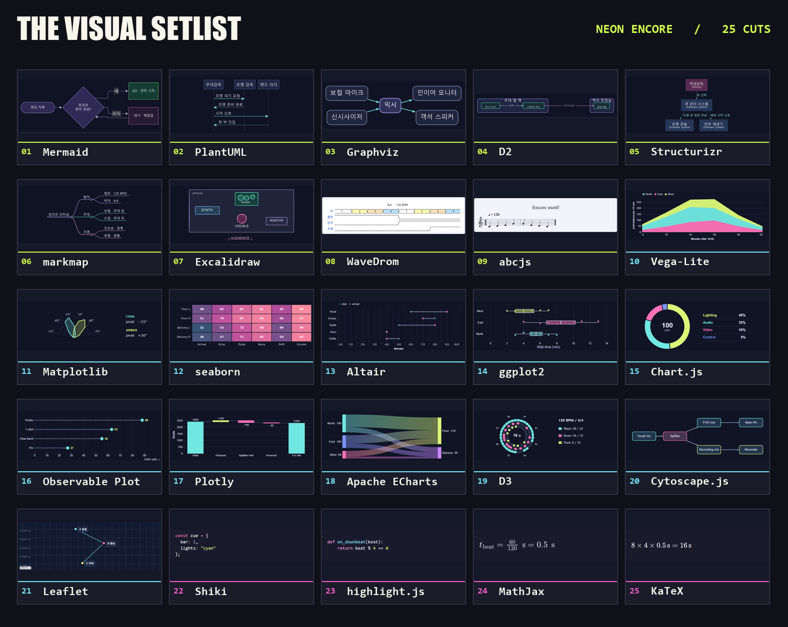

PlantUML·D2·Graphviz·Matplotlib·ECharts·abcjs 등 외부 도구를 직접 설치해 쓰고 싶을 때는 보존된 참고 도감을 확인하세요: [**구조·신호(9종)**](docs/structure.md) · [**데이터(12종)**](docs/data.md) · [**코드·수식(4종)**](docs/notation.md).

</details>

---

## 📁 저장소 구조

```text
md-viz/                              ← 저장소 루트 (MIT)
├── LICENSE                          ← MIT 오픈소스 라이선스
├── SECURITY.md                      ← 보안 정책과 책임 경계
├── README.md                        ← 영문 무설치 쇼케이스
├── .github/                         ← 자동화 워크플로
│   └── workflows/                   ← GitHub Actions 정의
│       └── ci.yml                   ← Ubuntu + Windows CI 검증
├── plugins/md-viz/                  ← 설치되는 3호스트 슬림 플러그인
│   ├── plugin.json                  ← Antigravity 설치 명세 (v0.4.0)
│   ├── LICENSE                      ← 동봉된 MIT 라이선스
│   ├── README.md                    ← 플러그인 자체 빠른 안내
│   └── skills/md-viz/               ← 공용 스킬·패턴·도구
│       ├── SKILL.md                 ← 무설치 GitHub README 전용 지침
│       └── scripts/                 ← 외부 의존성 0개 stdlib 도구
│           ├── badge.py             ← 28px 2톤 네온 SVG 배지 생성
│           ├── svg_chart.py         ← GitHub 안전 순수 SVG 10종
│           ├── gif_anim.py          ← 순수 stdlib 루프 GIF89a + PNG
│           ├── tree_gen.py          ← 실제 저장소 열 정렬 트리
│           └── check_env.py         ← 무설치 및 선택 엔진 사전 점검
├── docs/                            ← 도감과 생성된 시각 자산
│   ├── github-elements.md           ← GitHub 표현 실전 안내서
│   └── art/                         ← 무설치 SVG·GIF 및 아카이브
│       └── zero-install/            ← 순수 SVG 10종 + stdlib GIF/PNG
├── examples/                        ← 재현 가능한 쇼케이스 생성기
│   ├── badges.py                    ← 전체 20종 SVG 배지 재생성
│   ├── zero_install_showcase.py     ← 순수 SVG 10종 + GIF89a 재생성
│   └── data/                        ← 공연 JSON과 참고 예제
├── tools/                           ← 릴리스 패키징 도구
│   └── build_release_zip.py         ← 결정적 UTC 슬림 ZIP 빌더
└── tests/                           ← 자동 검증 및 릴리스 시험
```

저장소 루트에서 `python examples/badges.py`로 20종 SVG 배지를, `python examples/zero_install_showcase.py`로 10종 순수 SVG + GIF89a/PNG를 재생성하고, `python tools/build_release_zip.py --version v0.4.0 --out dist`로 결정적 슬림 플러그인 ZIP과 `SHA256SUMS.txt`를 빌드할 수 있습니다.
