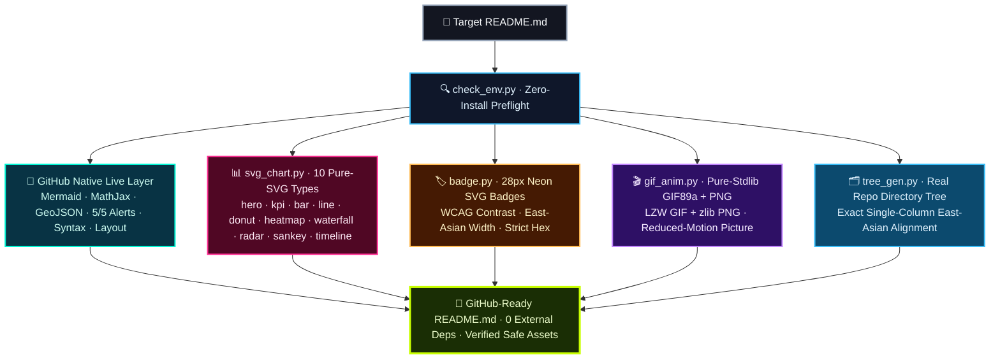
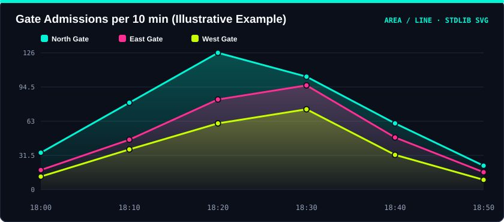
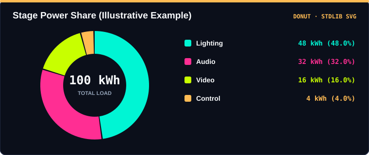
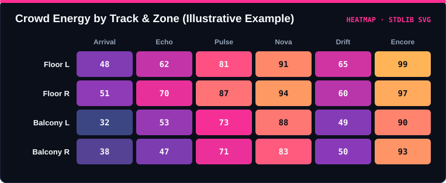
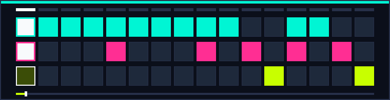
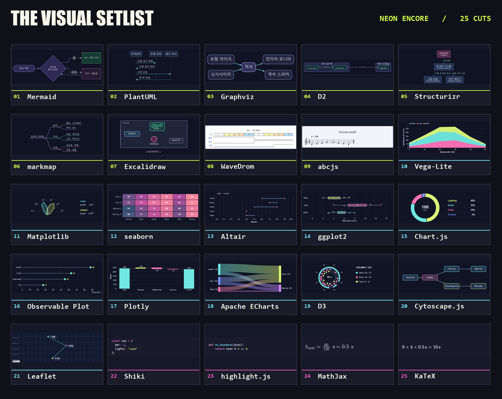

<div align="center">
  <strong>🌐 English</strong> · <a href="README.ko.md"><strong>🇰🇷 한국어 (Korean)</strong></a> · <a href="docs/github-elements.md"><strong>✨ GitHub Field Guide</strong></a> · <a href="plugins/md-viz/skills/md-viz/SKILL.md"><strong>📖 Skill Spec</strong></a>
</div>

<br>

<p align="center">
  
</p>

<h1 align="center">⚡ md-viz · Zero-Install GitHub README.md Visual Engine</h1>

<div align="center">
  <a href="plugins/md-viz/plugin.json"></a>
  <a href="LICENSE"></a>
  <a href=".github/workflows/ci.yml"></a>
  <a href="#-zero-install-svg--gif-visual-wall"></a>
  <a href="docs/github-elements.md"></a>
  <a href="#-install-in-one-command"></a>
</div>
<div align="center">
  <a href="#antigravity-cli-agy"></a>
  <a href="#claude-code"></a>
  <a href="#codex"></a>
  <a href="plugins/md-viz/skills/md-viz/scripts/check_env.py"></a>
</div>
<div align="center">
  <a href="#-live-zero-install-architecture"></a>
  <a href="plugins/md-viz/skills/md-viz/scripts/svg_chart.py"></a>
  <a href="plugins/md-viz/skills/md-viz/scripts/gif_anim.py"></a>
  <a href="#-live-interactive-geojson-map--github-native-layer"></a>
  <a href="#-live-mathjax--zero-install-animation"></a>
  <a href="docs/github-elements.md#알림-블록--공연-노트에서-무엇을-강조할까"></a>
</div>

<p align="center">
  <kbd>/md-viz</kbd> + <kbd>0 External Installs</kbd> + <kbd>GitHub Native (Mermaid · MathJax · GeoJSON · 5 Alerts)</kbd> + <kbd>Python Stdlib (10 SVG Charts · Badges · GIF89a · Tree)</kbd>
</p>

**Designed exclusively for stunning GitHub `README.md` files with zero setup friction.** GitHub strips `<script>` and external JS/CSS inside `README.md`, meaning only **Mermaid** and **MathJax** (plus `GeoJSON` maps) run natively. `md-viz v0.4.0` turns that constraint into a superpower: it combines every GitHub-native live renderer with **4 bundled Python 3 standard-library generators** (`badge.py`, `svg_chart.py`, `gif_anim.py`, `tree_gen.py`) — **zero `npm install`, zero `pip install`, zero Pillow, zero browser capture** — so `/md-viz` works 100% out of the box on Windows, macOS, and Linux.

---

## ⚡ Live Zero-Install Architecture

Rendered natively by GitHub's built-in Mermaid engine with high-contrast dark-neon `classDef` styling:



| Layer | Mechanism | External Install | GitHub `README.md` Rendering |
|---|---|:---:|---|
| **Mermaid** | ` ```mermaid ` fence | **0** | ✅ Native live SVG |
| **MathJax** | `$...$` / `$$...$$` / ` ```math ` | **0** | ✅ Native live equations |
| **GeoJSON / TopoJSON** | ` ```geojson ` / ` ```topojson ` | **0** | ✅ Native interactive vector map |
| **Alerts · Code · Layout** | `[!NOTE]`..`[!CAUTION]` · `<details>` · `<kbd>` | **0** | ✅ Native GitHub Markdown |
| **`svg_chart.py` (10 types)** | Python 3 stdlib → pure `<svg>` | **0** | ✅ GitHub ``-safe vector (`0` `<script>` / `<foreignObject>`) |
| **`badge.py`** | Python 3 stdlib → 28 px `<svg>` | **0** | ✅ GitHub ``-safe neon badge |
| **`gif_anim.py`** | Python 3 stdlib → LZW `.gif` + zlib `.png` | **0** | ✅ `<picture>` loop + `prefers-reduced-motion` still |
| **`tree_gen.py`** | Python 3 stdlib → ` ```text ` tree | **0** | ✅ Real filesystem, exact single-column `←` alignment |

---

## 🔥 Zero-Install SVG & GIF Visual Wall

> [!NOTE]
> Every SVG chart and the animated GIF/PNG loop below was generated strictly with the **Python 3 standard library** from [`examples/data/show.json`](examples/data/show.json) (our **NEON ENCORE** illustrative dataset) via [`examples/zero_install_showcase.py`](examples/zero_install_showcase.py) — zero `matplotlib`, zero `Node.js`, zero `Pillow`.

[](examples/data/show.json)

<details open>
<summary><strong>📊 All 10/10 Pure-SVG Visual Types (Generated by <code>scripts/svg_chart.py</code> · 0 Dependencies)</strong></summary>

| 🧭 `kpi` · Metric Strip | 📊 `bar` · Ranked Comparison | 📈 `line` · Multi-Series Area |
|:---:|:---:|:---:|
|  |  |  |
| 🍩 **`donut` · Proportion Ring** | 🔥 **`heatmap` · Intensity Matrix** | 💧 **`waterfall` · Delta Breakdown** |
|  |  |  |
| 🎯 **`radar` · Polar Spider** | 🌊 **`sankey` · Proportional Flow** | 🎛️ **`timeline` · Step Matrix** |
|  |  |  |

*(Type #10, `hero`, is the banner at the very top of this README.)*

</details>

> [!CAUTION]
> Running `python examples/zero_install_showcase.py` overwrites the tracked SVG/GIF/PNG files under `docs/art/zero-install/`. When experimenting with custom specs, write to a separate folder with `python plugins/md-viz/skills/md-viz/scripts/svg_chart.py --out preview/chart.svg`.

---

## 🎬 Live MathJax & Zero-Install Animation

GitHub natively renders **MathJax** equations directly in `README.md`:

$$\Delta t_{\text{beat}} = \frac{60}{120\text{ BPM}} = 0.5\text{ s}, \qquad T_{8\text{ bars}} = 8 \times 4 \times 0.5\text{ s} = 16\text{ s}$$

And [`scripts/gif_anim.py`](plugins/md-viz/skills/md-viz/scripts/gif_anim.py) encodes a **looping GIF89a + identical-dimension reduced-motion PNG** using pure Python `struct` + `zlib` + LZW (zero `Pillow` required):

<picture>
  <source media="(prefers-reduced-motion: reduce)" srcset="docs/art/zero-install/cue-loop.png">
  
</picture>

<picture>
  <source media="(prefers-reduced-motion: reduce)" srcset="docs/art/cue-player.png">
  
</picture>

---

## 🌍 Live Interactive GeoJSON Map & GitHub Native Layer

GitHub renders the `geojson` block below as a **live, zoomable, clickable vector map** synchronized with [`docs/art/elements/shuttle.geojson`](docs/art/elements/shuttle.geojson):

```geojson
{
  "type": "FeatureCollection",
  "features": [
    {
      "type": "Feature",
      "properties": {"title": "A · 집결", "marker-color": "#27aaa6"},
      "geometry": {"type": "Point", "coordinates": [126.9754, 37.5741]}
    },
    {
      "type": "Feature",
      "properties": {"title": "B · 환승", "marker-color": "#d33b90"},
      "geometry": {"type": "Point", "coordinates": [126.9836, 37.5708]}
    },
    {
      "type": "Feature",
      "properties": {"title": "C · 무대", "marker-color": "#799326"},
      "geometry": {"type": "Point", "coordinates": [126.9774, 37.5662]}
    },
    {
      "type": "Feature",
      "properties": {"title": "방문 순서 A → B → C", "stroke": "#228582"},
      "geometry": {
        "type": "LineString",
        "coordinates": [[126.9754, 37.5741], [126.9836, 37.5708], [126.9774, 37.5662]]
      }
    }
  ]
}
```

> [!WARNING]
> GeoJSON coordinates strictly follow **`[longitude, latitude]`** order. Swapping Seoul's longitude (`126.9754`) into the latitude slot produces an invalid out-of-range coordinate (`|lat| > 90`). Inspect the validated coordinates in [`docs/art/elements/shuttle.geojson`](docs/art/elements/shuttle.geojson).

Explore copy-paste patterns in [**✨ GitHub Markdown Field Guide**](docs/github-elements.md) and [**📐 Zero-Install Pattern Reference**](plugins/md-viz/skills/md-viz/references/markdown-patterns.md).

---

## 🔌 Install in One Command

All three AI coding agents install the **exact same single-source plugin** (`plugins/md-viz/`, MIT licensed) with **5 stdlib-only Python scripts** (`badge.py`, `svg_chart.py`, `gif_anim.py`, `tree_gen.py`, `check_env.py`).

### Antigravity CLI (`agy`)

```sh
agy plugin install https://github.com/Technoetic/md-viz/tree/main/plugins/md-viz
```

> <kbd>/md-viz</kbd> `Upgrade README.md with zero-install GitHub visuals: live Mermaid, MathJax, 5 alerts, neon SVG badges, dark-neon SVG charts, animated GIF+PNG loop, and an aligned repo tree.`

### Claude Code

```sh
claude plugin marketplace add Technoetic/md-viz
claude plugin install md-viz@technoetic-md-viz
```

> <kbd>/md-viz:md-viz</kbd> `Visualize this repository's README.md using zero-install GitHub native syntax and bundled stdlib SVG/GIF generators.`

### Codex

```sh
codex plugin marketplace add Technoetic/md-viz
codex plugin add md-viz@technoetic-md-viz
```

> <kbd>$md-viz:md-viz</kbd> `Turn README.md into a high-contrast zero-install GitHub visual showcase and verify every generated asset.`

### 🔍 Instant Zero-Install Verification

```sh
python plugins/md-viz/skills/md-viz/scripts/check_env.py
```

> [!IMPORTANT]
> **Python 3 is the only prerequisite.** Every bundled generator (`badge.py`, `svg_chart.py`, `gif_anim.py`, `tree_gen.py`, `check_env.py`) uses 100% Python standard library modules — no `pip install`, no `npm install`, no headless browser required.

> [!TIP]
> Pass `--readme README.md --slot <id>` to `svg_chart.py`, `gif_anim.py`, or `tree_gen.py` to insert or idempotently refresh `<!-- md-viz:start:<id> -->` blocks using verified relative POSIX paths.

---

## 📚 Optional External 25-Engine Reference Archive

<details>
<summary><strong>Click to browse the pre-rendered 25-library NEON ENCORE reference gallery (optional external tools)</strong></summary>

<br>

<div align="center">
  <a href="docs/structure.md"></a>
  <a href="docs/data.md"></a>
  <a href="docs/notation.md"></a>
</div>

<br>



If you explicitly want external pre-rendered PNGs from tools like PlantUML, D2, Graphviz, Matplotlib, ECharts, or abcjs, inspect the archived reference chapters: [**Structure (9)**](docs/structure.md) · [**Data (12)**](docs/data.md) · [**Code & Math (4)**](docs/notation.md).

</details>

---

## 📁 Repository Architecture

```text
md-viz/                              ← Repository root (MIT)
├── LICENSE                          ← MIT open-source license
├── SECURITY.md                      ← Security policy & boundaries
├── README.ko.md                     ← Full Korean showcase parity
├── .github/                         ← Automation workflows
│   └── workflows/                   ← GitHub Actions definitions
│       └── ci.yml                   ← Ubuntu + Windows CI & ZIP check
├── plugins/md-viz/                  ← Slim installable 3-host plugin
│   ├── plugin.json                  ← Antigravity manifest (v0.4.0)
│   ├── LICENSE                      ← Bundled MIT license
│   ├── README.md                    ← Plugin-local quick-start
│   └── skills/md-viz/               ← Shared skill, patterns & tools
│       ├── SKILL.md                 ← Zero-install GitHub README spec
│       └── scripts/                 ← Zero-dependency stdlib scripts
│           ├── badge.py             ← 28px two-tone neon SVG badges
│           ├── svg_chart.py         ← 10 GitHub-safe pure-SVG charts
│           ├── gif_anim.py          ← Stdlib animated GIF89a + PNG
│           ├── tree_gen.py          ← Real-repo column-aligned tree
│           └── check_env.py         ← Zero-install & optional preflight
├── docs/                            ← Galleries & generated visuals
│   ├── github-elements.md           ← GitHub Markdown field guide
│   └── art/                         ← Zero-install SVGs, GIFs & archive
│       └── zero-install/            ← 10 pure SVGs + stdlib GIF/PNG
├── examples/                        ← Reproducible showcase generators
│   ├── badges.py                    ← Regenerate all 20 SVG badges
│   ├── zero_install_showcase.py     ← Regenerate 10 SVGs + GIF89a/PNG
│   └── data/                        ← Show JSON & archive samples
├── tools/                           ← Release engineering helpers
│   └── build_release_zip.py         ← Deterministic UTC slim ZIP
└── tests/                           ← Unit, hygiene & release tests
```

Regenerate all 20 SVG badges with `python examples/badges.py`, regenerate all 10 zero-install SVGs + GIF89a/PNG with `python examples/zero_install_showcase.py`, or build a deterministic slim plugin ZIP with `python tools/build_release_zip.py --version v0.4.0 --out dist`.
