<div align="center">
  <strong>🌐 English</strong> · <a href="README.ko.md"><strong>🇰🇷 한국어 (Korean)</strong></a> · <a href="docs/github-elements.md"><strong>✨ GitHub Techniques (6+4)</strong></a> · <a href="plugins/md-viz/skills/md-viz/SKILL.md"><strong>📖 Skill Spec</strong></a>
</div>

<br>

<picture>
  <source media="(prefers-reduced-motion: reduce)" srcset="docs/art/cover.png">
  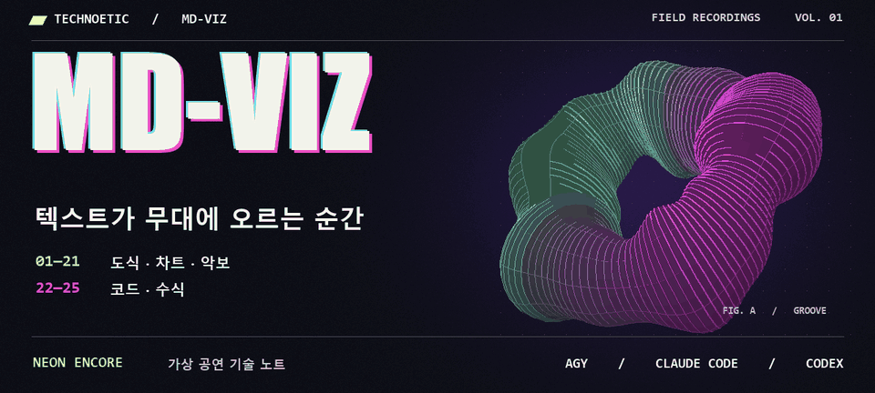
</picture>

<h1 align="center">⚡ md-viz · Full-Arsenal High-Impact Markdown Visualizer</h1>

<div align="center">
  <a href="plugins/md-viz/plugin.json"></a>
  <a href="LICENSE"></a>
  <a href=".github/workflows/ci.yml"></a>
  <a href="#-full-25-engine-inline-visual-wall"></a>
  <a href="docs/github-elements.md"></a>
  <a href="#-install-in-one-command"></a>
</div>
<div align="center">
  <a href="#antigravity-cli-agy"></a>
  <a href="#claude-code"></a>
  <a href="#codex"></a>
  <a href="plugins/md-viz/skills/md-viz/scripts/check_env.py"></a>
</div>
<div align="center">
  <a href="docs/structure.md"></a>
  <a href="docs/data.md"></a>
  <a href="docs/notation.md"></a>
  <a href="docs/github-elements.md#알림-블록--공연-노트에서-무엇을-강조할까"></a>
</div>
<div align="center">
  <a href="#-live-visual-overdrive-pipeline"></a>
  <a href="docs/structure.md#첫-멜로디--abcjs"></a>
  <a href="docs/data.md#d3--한-박씩-돌려-보면-어떤-조명이-켜질까"></a>
  <a href="#-live-interactive-geojson-map--github-techniques"></a>
  <a href="docs/notation.md#다음-큐까지-몇-초를-셀까--katex"></a>
</div>

<p align="center">
  <kbd>/md-viz</kbd> + <kbd>25 Rendering Libraries</kbd> + <kbd>6 Core GitHub Techniques</kbd> + <kbd>4 Native Boosters</kbd> → <strong>Maximum Visual Impact Without Inventing a Single Fact</strong>
</p>

**Turn plain Markdown into an electrifying, multi-lens visual showcase.** Give `md-viz` a rehearsal note — *"120 BPM, 4/4 time, first bar C–D–E–G"* — and it fires every fitting renderer in parallel: sheet music for the band (**abcjs**), beat-accurate timing switches for lighting (**WaveDrom**), radial cue wheels (**D3**), Sankey crowd flow (**ECharts**), interactive maps (**GeoJSON** + **Leaflet**), syntax-lit code (**Shiki** + **highlight.js**), crisp equations (**KaTeX** + **MathJax** + native `$$...$$`), animated beat-sync GIFs, neon SVG badge walls, aligned directory trees, and all 5 GitHub alerts — **all directly inside your document**.

---

## ⚡ Live Visual Overdrive Pipeline

Here is how `md-viz` inspects your machine with `scripts/check_env.py` and fans out a single Markdown draft across **25 visualization libraries** and **6+4 GitHub-native techniques** (rendered live by GitHub's native Mermaid engine with high-contrast neon `classDef` styling):

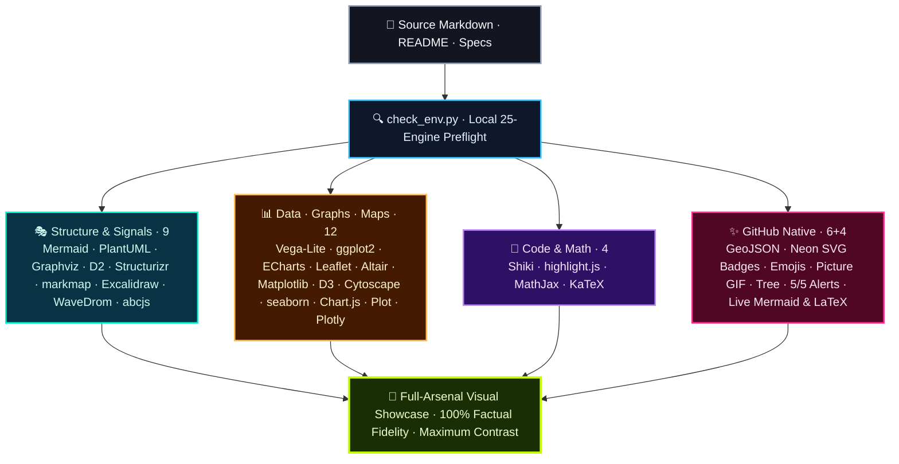

---

## 🎵 Eight Notes → Multi-Engine Impact

> [!NOTE]
> **NEON ENCORE** is a fictional concert crafted specifically to stress-test all **25 rendering libraries** and **6+4 GitHub Markdown techniques** against one shared dataset ([`examples/data/show.json`](examples/data/show.json)). Every chart, map, score, waveform, and formula below is generated from real code in [`examples/`](examples).

[](examples/data/show.json)

Drop eight quarter notes (`C D E G | G E D C |]`) into ABC notation and pair the live GitHub LaTeX equation with four simultaneous visual lenses (**abcjs**, **WaveDrom**, **KaTeX**, and **D3**):

$$\Delta t_{\text{beat}} = \frac{60}{120\text{ BPM}} = 0.5\text{ s}, \qquad T_{8\text{ bars}} = 8 \times 4 \times 0.5\text{ s} = 16\text{ s}$$

| 🎼 Sheet Music (`abcjs`) | ⚡ Beat Switch Timing (`WaveDrom`) |
|:---:|:---:|
| [](docs/structure.md#첫-멜로디--abcjs) | [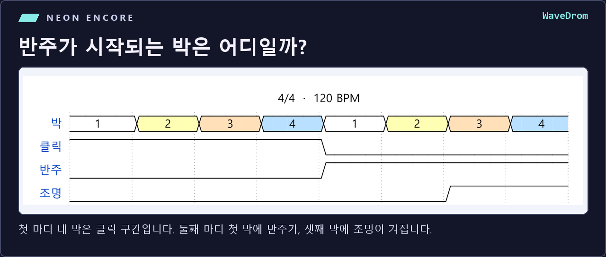](docs/structure.md#박자에-맞춘-스위치--wavedrom) |
| 🧮 **Queue Duration Formula (`KaTeX`)** | 🎡 **32-Beat Radial Sequencer (`D3`)** |
| [](docs/notation.md#다음-큐까지-몇-초를-셀까--katex) | [](docs/data.md#d3--한-박씩-돌려-보면-어떤-조명이-켜질까) |

### 🎬 Beat-Synced Animated Cue Player (`<picture>` Motion-Safe Loop)

<picture>
  <source media="(prefers-reduced-motion: reduce)" srcset="docs/art/cue-player.png">
  
</picture>

Bright cells fire on the active beat. Read vertically to see simultaneous fixtures; readers with `prefers-reduced-motion: reduce` automatically receive the crisp still frame [`cue-player.png`](docs/art/cue-player.png).

---

## 🔥 Full 25-Engine Inline Visual Wall


Every single one of the **25 libraries** is rendered live right below — click any card to inspect its full walkthrough and raw source code.

<details open>
<summary><strong>🎭 Wing 1 · Structure, Architecture, Signals & Sheet Music — All 9/9 Libraries</strong></summary>

| 🔀 Mermaid · Flow Gate | 💬 PlantUML · Sequence | 🕸️ Graphviz · Signal DAG |
|:---:|:---:|:---:|
| [](docs/structure.md#시작-판단--mermaid)<br>[Walkthrough](docs/structure.md#시작-판단--mermaid) · [`.mmd`](examples/structure/cue-gate.mmd) | [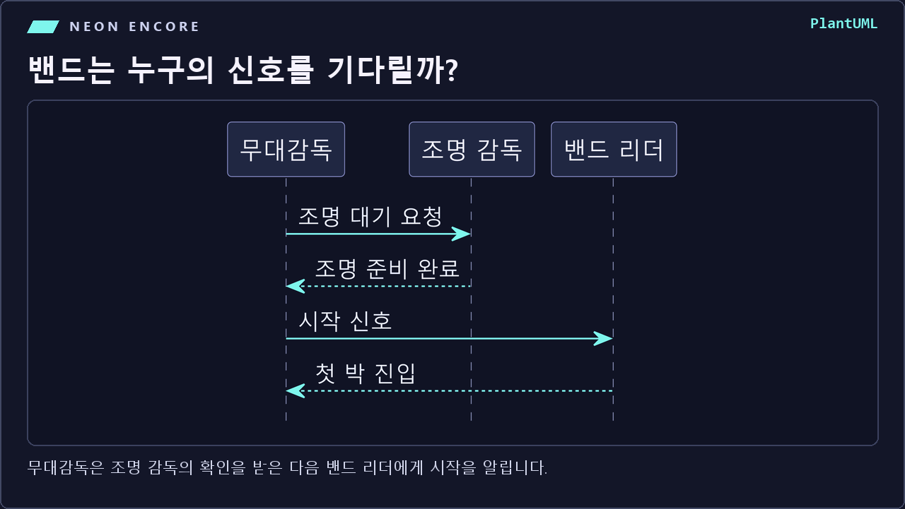](docs/structure.md#호출과-응답--plantuml)<br>[Walkthrough](docs/structure.md#호출과-응답--plantuml) · [`.puml`](examples/structure/standby.puml) | [](docs/structure.md#소리의-갈림길--graphviz)<br>[Walkthrough](docs/structure.md#소리의-갈림길--graphviz) · [`.dot`](examples/structure/signal-path.dot) |
| 🧩 **D2 · Rack Topology** | 🏛️ **Structurizr · C4 Context** | 🌿 **markmap · Mind Map** |
| [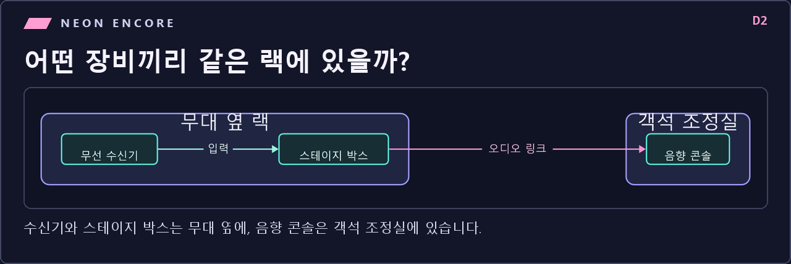](docs/structure.md#장비의-위치--d2)<br>[Walkthrough](docs/structure.md#장비의-위치--d2) · [`.d2`](examples/structure/patch-bays.d2) | [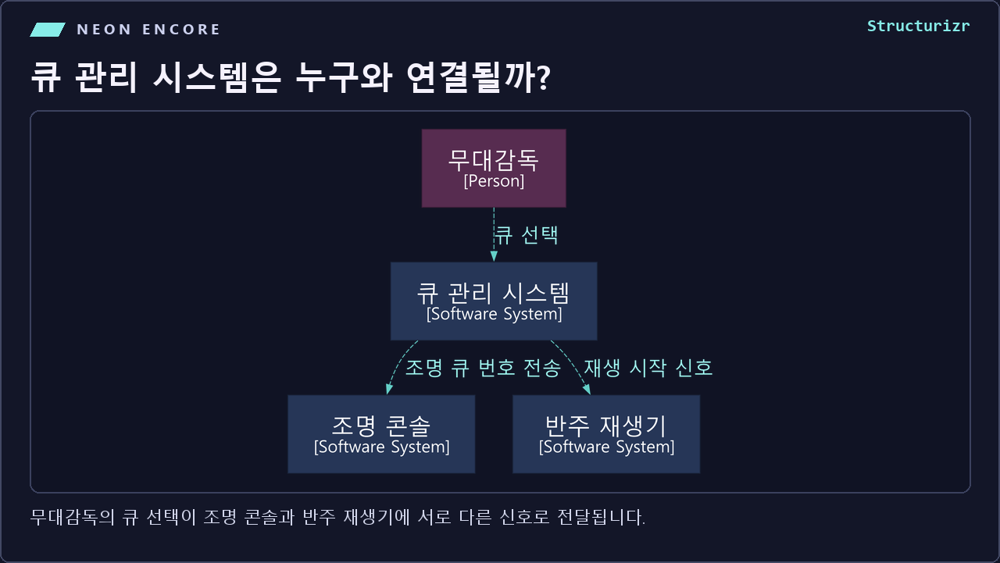](docs/structure.md#시스템의-경계--structurizr)<br>[Walkthrough](docs/structure.md#시스템의-경계--structurizr) · [`.dsl`](examples/structure/cue-desk.dsl) | [](docs/structure.md#노트의-가지--markmap)<br>[Walkthrough](docs/structure.md#노트의-가지--markmap) · [`.md`](examples/structure/set-notes.md) |
| ✏️ **Excalidraw · Stage Plot** | 📡 **WaveDrom · Timing** | 🎼 **abcjs · Sheet Music** |
| [](docs/structure.md#관객이-보는-무대--excalidraw)<br>[Walkthrough](docs/structure.md#관객이-보는-무대--excalidraw) · [`.js`](examples/structure/stage-plot.js) | [](docs/structure.md#박자에-맞춘-스위치--wavedrom)<br>[Walkthrough](docs/structure.md#박자에-맞춘-스위치--wavedrom) · [`.json`](examples/structure/count-in.json) | [](docs/structure.md#첫-멜로디--abcjs)<br>[Walkthrough](docs/structure.md#첫-멜로디--abcjs) · [`.abc`](examples/structure/encore.abc) |

</details>

<details open>
<summary><strong>📊 Wing 2 · Data, Statistics, Networks & Geospatial Maps — All 12/12 Libraries</strong></summary>

| 📈 Vega-Lite · Stacked Area | 📦 ggplot2 · Wait Boxplot | 🌊 Apache ECharts · Sankey |
|:---:|:---:|:---:|
| [](docs/data.md#vega-lite--언제-입장객이-몰렸을까)<br>[Walkthrough](docs/data.md#vega-lite--언제-입장객이-몰렸을까) | [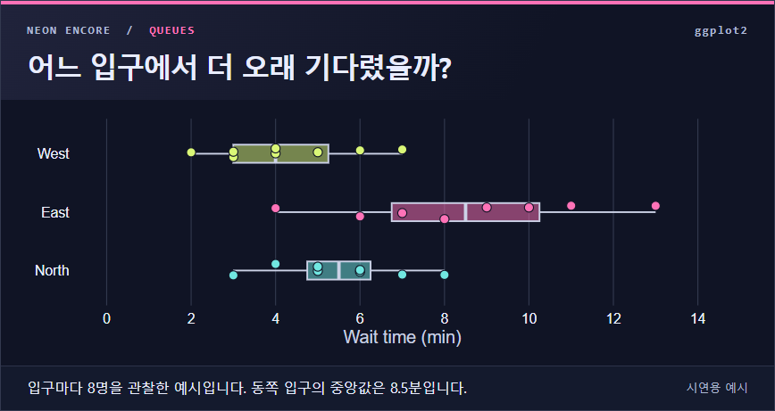](docs/data.md#ggplot2--입구별로-관객은-얼마나-기다렸을까)<br>[Walkthrough](docs/data.md#ggplot2--입구별로-관객은-얼마나-기다렸을까) | [](docs/data.md#apache-echarts--세-입구를-통과한-사람들은-어디로-갔을까)<br>[Walkthrough](docs/data.md#apache-echarts--세-입구를-통과한-사람들은-어디로-갔을까) |
| 🧭 **Leaflet · Route Map** | 🏋️ **Altair · Dumbbell Delta** | 🎯 **Matplotlib · Polar Beam** |
| [](docs/data.md#leaflet--집결점에서-무대까지-어느-방향으로-움직일까)<br>[Walkthrough](docs/data.md#leaflet--집결점에서-무대까지-어느-방향으로-움직일까) | [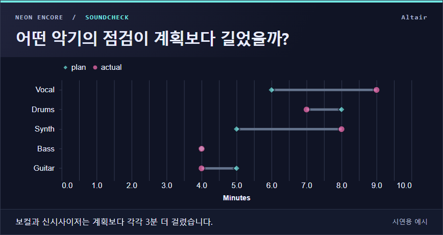](docs/data.md#altair--사운드체크-계획은-어디서-어긋났을까)<br>[Walkthrough](docs/data.md#altair--사운드체크-계획은-어디서-어긋났을까) | [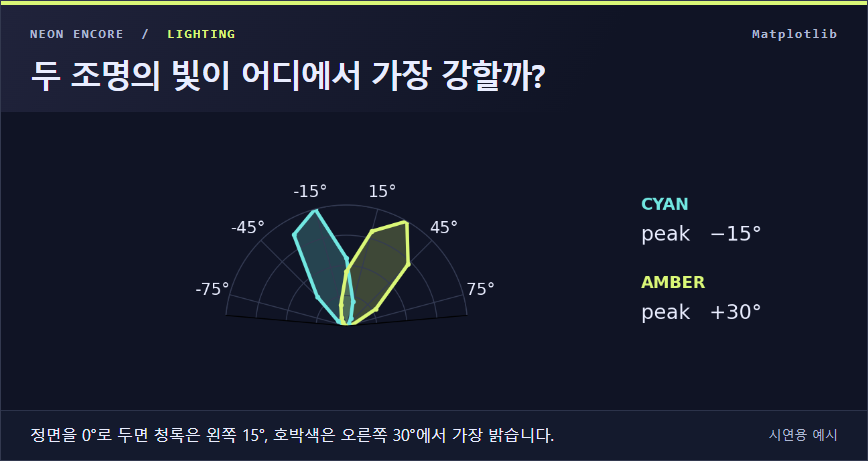](docs/data.md#matplotlib--두-조명의-밝은-방향은-어디일까)<br>[Walkthrough](docs/data.md#matplotlib--두-조명의-밝은-방향은-어디일까) |
| 🎡 **D3 · Radial Sequencer** | 🧬 **Cytoscape.js · Audio Mesh** | 🔥 **seaborn · Crowd Heatmap** |
| [](docs/data.md#d3--한-박씩-돌려-보면-어떤-조명이-켜질까)<br>[Walkthrough](docs/data.md#d3--한-박씩-돌려-보면-어떤-조명이-켜질까) | [](docs/data.md#cytoscapejs--보컬-소리가-녹음기까지-가는-길은)<br>[Walkthrough](docs/data.md#cytoscapejs--보컬-소리가-녹음기까지-가는-길은) | [](docs/data.md#seaborn--어느-곡에서-객석-전체가-함께-반응했을까)<br>[Walkthrough](docs/data.md#seaborn--어느-곡에서-객석-전체가-함께-반응했을까) |
| 🍩 **Chart.js · Power Donut** | 🏆 **Observable Plot · Merch Rank** | 💧 **Plotly · Seat Waterfall** |
| [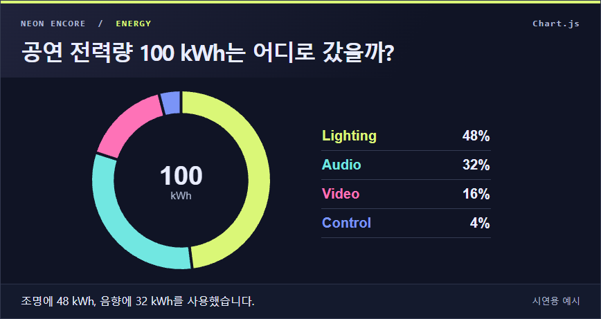](docs/data.md#chartjs--무엇이-전기를-가장-많이-썼을까)<br>[Walkthrough](docs/data.md#chartjs--무엇이-전기를-가장-많이-썼을까) | [](docs/data.md#observable-plot--가장-잘-팔린-기념품은)<br>[Walkthrough](docs/data.md#observable-plot--가장-잘-팔린-기념품은) | [](docs/data.md#plotly--좌석-증감이-최종-판매-수를-어떻게-바꿨을까)<br>[Walkthrough](docs/data.md#plotly--좌석-증감이-최종-판매-수를-어떻게-바꿨을까) |

</details>

<details open>
<summary><strong>🧮 Wing 3 · Code Syntax Highlighting & Mathematical Typography — All 4/4 Libraries</strong></summary>

| 💎 Shiki · Static Highlight | 🔦 highlight.js · Dynamic Highlight |
|:---:|:---:|
| [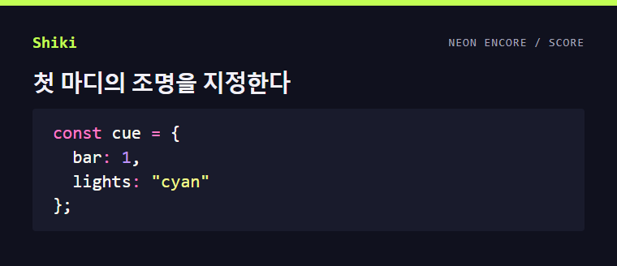](docs/notation.md#첫-조명은-무슨-색일까--shiki)<br>[Walkthrough](docs/notation.md#첫-조명은-무슨-색일까--shiki) | [](docs/notation.md#어느-박에서-조명을-바꿀까--highlightjs)<br>[Walkthrough](docs/notation.md#어느-박에서-조명을-바꿀까--highlightjs) |
| 📐 **MathJax · TeX SVG Equation** | ⚡ **KaTeX · Fast HTML/MathML** |
| [](docs/notation.md#한-박의-길이는--mathjax)<br>[Walkthrough](docs/notation.md#한-박의-길이는--mathjax) | [](docs/notation.md#다음-큐까지-몇-초를-셀까--katex)<br>[Walkthrough](docs/notation.md#다음-큐까지-몇-초를-셀까--katex) |

</details>

> [!CAUTION]
> Re-rendering the data gallery overwrites existing PNG files under `docs/art/data/` by default. To preview regenerated charts safely without clobbering tracked assets, pass an alternate output directory: `python render.py --output preview` inside [`examples/data/`](examples/data/README.md#출력).

---

## 🌍 Live Interactive GeoJSON Map & GitHub Techniques

GitHub renders the `geojson` block below as a **live, zoomable, clickable vector map** directly inside this README — synchronized with [`docs/art/elements/shuttle.geojson`](docs/art/elements/shuttle.geojson) and [`examples/data/show.json`](examples/data/show.json):

```geojson
{
  "type": "FeatureCollection",
  "features": [
    {
      "type": "Feature",
      "properties": {"title": "A · 집결", "marker-color": "#27aaa6"},
      "geometry": {"type": "Point", "coordinates": [126.9754, 37.5741]}
    },
    {
      "type": "Feature",
      "properties": {"title": "B · 환승", "marker-color": "#d33b90"},
      "geometry": {"type": "Point", "coordinates": [126.9836, 37.5708]}
    },
    {
      "type": "Feature",
      "properties": {"title": "C · 무대", "marker-color": "#799326"},
      "geometry": {"type": "Point", "coordinates": [126.9774, 37.5662]}
    },
    {
      "type": "Feature",
      "properties": {"title": "방문 순서 A → B → C", "stroke": "#228582"},
      "geometry": {
        "type": "LineString",
        "coordinates": [[126.9754, 37.5741], [126.9836, 37.5708], [126.9774, 37.5662]]
      }
    }
  ]
}
```

> [!WARNING]
> GeoJSON coordinates strictly follow **`[longitude, latitude]`** order. Swapping Seoul's longitude (`126.9754`) into the latitude slot produces an invalid out-of-range coordinate (`|lat| > 90`). Inspect the validated coordinates in [`docs/art/elements/shuttle.geojson`](docs/art/elements/shuttle.geojson).

Explore all 6 core GitHub Markdown patterns + copyable templates in the full field guide: [**✨ GitHub Markdown Field Guide**](docs/github-elements.md) and [**📐 Copy-Paste Pattern Reference**](plugins/md-viz/skills/md-viz/references/markdown-patterns.md).

---

## 🔌 Install in One Command

All three AI coding agents install the **exact same single-source plugin** (`plugins/md-viz/`, MIT licensed) bundling `SKILL.md`, `markdown-patterns.md`, `scripts/badge.py`, and `scripts/check_env.py`.

### Antigravity CLI (`agy`)

```sh
agy plugin install https://github.com/Technoetic/md-viz/tree/main/plugins/md-viz
```

> <kbd>/md-viz</kbd> `Turn README.md into a maximum-impact visual showcase using every applicable library and GitHub technique.`

### Claude Code

```sh
claude plugin marketplace add Technoetic/md-viz
claude plugin install md-viz@technoetic-md-viz
```

> <kbd>/md-viz:md-viz</kbd> `Visualize the architecture, metrics, and timing flow in this spec with maximum visual contrast.`

### Codex

```sh
codex plugin marketplace add Technoetic/md-viz
codex plugin add md-viz@technoetic-md-viz
```

> <kbd>$md-viz:md-viz</kbd> `Convert every table, workflow, and formula in README.md into vivid visuals and report exact tool coverage.`

### 🔍 Local Renderer Preflight (Zero Dependencies)

Run the bundled preflight script anytime to see which of the 25 engines are ready on your machine:

```sh
python plugins/md-viz/skills/md-viz/scripts/check_env.py
```

> [!IMPORTANT]
> The plugin installs orchestration rules plus two zero-dependency Python stdlib scripts (`badge.py` and `check_env.py`). External diagram, chart, and math engines must be available locally when generating new images; all pre-rendered gallery assets in this repo work immediately on GitHub and offline. See [`examples/data/README.md`](examples/data/README.md#준비).

> [!TIP]
> Default invocation goes **full-throttle** across all 25 engines and 6+4 GitHub patterns — or narrow it anytime with a single phrase like *"Mermaid flowchart only"* or *"generate one neon SVG badge with `badge.py`"*.

---

## 📁 Repository Architecture

```text
md-viz/                         ← Repository root (MIT)
├── LICENSE                     ← MIT open-source license
├── SECURITY.md                 ← Security policy & boundaries
├── README.ko.md                ← Full Korean showcase parity
├── .github/                    ← Automation workflows
│   └── workflows/              ← GitHub Actions definitions
│       └── ci.yml              ← Ubuntu + Windows CI & ZIP check
├── plugins/md-viz/             ← Slim installable 3-host plugin
│   ├── plugin.json             ← Antigravity manifest (v0.3.0)
│   ├── LICENSE                 ← Bundled MIT license
│   ├── README.md               ← Plugin-local quick-start
│   └── skills/md-viz/          ← Shared skill, patterns & tools
│       ├── SKILL.md            ← Full-arsenal overdrive spec
│       └── scripts/            ← Zero-dependency stdlib scripts
│           ├── badge.py        ← 28px two-tone neon SVG badges
│           └── check_env.py    ← 25-engine local preflight
├── docs/                       ← 25-tool galleries & live art
│   ├── github-elements.md      ← Live 6-pattern field guide
│   └── art/                    ← Rendered PNG, GIF, SVG & GeoJSON
├── examples/                   ← Reproducible inputs & renderers
│   ├── badges.py               ← Regenerate all 20 SVG badges
│   └── data/                   ← Show JSON & 12-chart pipeline
├── tools/                      ← Release engineering helpers
│   └── build_release_zip.py    ← Deterministic UTC slim ZIP
└── tests/                      ← Gallery, badge & plugin tests
```

Regenerate all 20 SVG badges byte-identically from the repo root with `python examples/badges.py`, or build a deterministic slim plugin ZIP with `python tools/build_release_zip.py --version v0.3.0 --out dist`.
