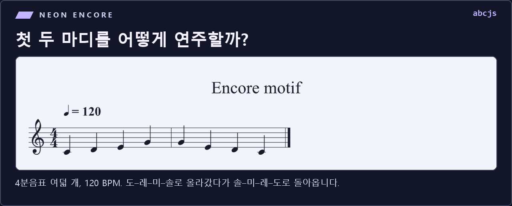
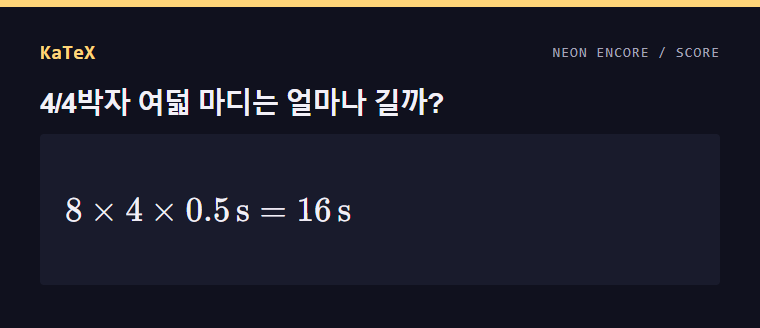
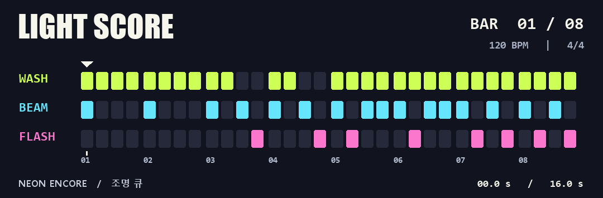

<picture>
  <source media="(prefers-reduced-motion: reduce)" srcset="docs/art/cover.png">
  
</picture>

# md-viz · 마크다운 시각화 플러그인

리허설 노트에 **“120 BPM, 4/4박자, 첫 마디는 도·레·미·솔”**이라고 적혀 있습니다. 연주자에게는 악보가, 조명 담당자에게는 어느 박에 스위치를 켤지 보여 주는 그림이 필요합니다. `md-viz`는 독자가 답을 찾을 수 있는 도구를 골라 그림을 만들고, 원문의 해당 문장 옆에 넣습니다.

**[내 도구에 설치하기](#설치하기) · [25종 시각화 보기](#25종-시각화-도감) · [스킬 원문 읽기](plugins/md-viz/skills/md-viz/SKILL.md)**

## 여덟 음을 붙여 넣으면

아래는 가상 공연 **NEON ENCORE**를 위해 쓴 두 마디입니다. 두 번째 마디에서는 첫 번째 마디를 거슬러 돌아옵니다.

```text
X:1
T:Encore motif
M:4/4
L:1/4
Q:1/4=120
K:C
C D E G | G E D C |]
```

[](docs/structure.md#첫-멜로디--abcjs)

120 BPM에서는 한 박이 0.5초이므로 이 악보는 4초입니다. 같은 템포에서 조명 여덟 마디를 프로그래밍하려면 16초가 필요합니다. 아래 두 그림을 열면 **몇 번째 박**과 **몇 초 뒤**라는 질문에 각각 답할 수 있습니다.

| 조명의 스위치는 어느 박에 바뀔까? | 여덟 마디가 끝나는 시각은? |
|---|---|
| [](docs/structure.md#박자에-맞춘-스위치--wavedrom) | [](docs/notation.md#다음-큐까지-몇-초를-셀까--katex) |

## 설치하기

사용하는 도구 하나를 골라 터미널에서 해당 명령을 실행하세요. 새 대화를 열면 예시처럼 호출할 수 있습니다. 세 플러그인은 동일한 스킬 본문을 읽습니다.

### Antigravity CLI (agy)

```sh
agy plugin install https://github.com/Technoetic/md-viz/tree/main/plugins/md-viz
```

> `/md-viz README.md의 설치 순서를 처음 쓰는 사람이 따라갈 수 있게 그림으로 보여 줘.`

### Claude Code

```sh
claude plugin marketplace add Technoetic/md-viz
claude plugin install md-viz@technoetic-md-viz
```

> `/md-viz:md-viz 리허설 노트에서 조명팀과 음향팀이 신호를 주고받는 순서를 그려 줘.`

### Codex

```sh
codex plugin marketplace add Technoetic/md-viz
codex plugin add md-viz@technoetic-md-viz
```

> `$md-viz:md-viz README.md의 표를 그래프로 바꾸고, 원본 값과 단위가 일치하는지 확인해 줘.`

플러그인은 시각화 지침을 설치합니다. 실제 제작에는 선택한 렌더러가 필요합니다. 이 저장소의 완성된 그림은 GitHub와 오프라인에서 이미지로 볼 수 있습니다.

## 25종 시각화 도감

**25개 도구가 같은 가상 공연을 서로 다른 자리에서 봅니다.** 무대감독은 시작 신호를 따라가고, 객석 담당자는 입장 흐름을 읽고, 조명 담당자는 박자를 시간으로 바꿉니다. 공연 수치와 악곡은 이 도감을 위한 시연용 예시입니다. 각 도감에는 그림, 해설, 입력 원본이 함께 있습니다.

<picture>
  <source media="(prefers-reduced-motion: reduce)" srcset="docs/art/cue-player.png">
  
</picture>

밝은 칸이 켜질 박입니다. 세로로 읽으면 그 순간에 함께 켜질 조명이 보입니다. 같은 32박을 원형으로 펼친 D3 그림과 비교해 보세요. [원형 조명 큐 보기](docs/data.md#d3--한-박씩-돌려-보면-어떤-조명이-켜질까)


| 도감 | 들어 있는 도구 |
|---|---|
| [**무대 뒤의 아홉 장면** · 9종](docs/structure.md) | Mermaid · PlantUML · Graphviz · D2 · Structurizr · markmap · Excalidraw · WaveDrom · abcjs |
| [**입장부터 앙코르까지, 공연 데이터** · 12종](docs/data.md) | Vega-Lite · Matplotlib · seaborn · Altair · ggplot2 · Chart.js · Observable Plot · Plotly · Apache ECharts · D3 · Cytoscape.js · Leaflet |
| [**공연 기술 노트의 코드와 수식** · 4종](docs/notation.md) | Shiki · highlight.js · MathJax · KaTeX |

### 내 문서에 적용하기

- **그림 한 장이 필요할 때** — “이 장애 대응 절차의 분기만 Mermaid 한 장으로 그려 줘.”
- **기존 README 전체를 바꿀 때** — “25종을 검토해서 이 원고에 맞는 도구를 최대한 활용해 줘. 코드는 복사할 수 있게 두고, 그림에는 대체 텍스트를 붙여 줘.”
- **블로그에 옮길 때** — “네이버 블로그에 붙여 넣을 글이야. 그림은 PNG로 내보내고 식은 글로도 읽을 수 있게 해 줘.”

도구 선택 기준과 게시 환경별 출력 방식은 [스킬 원문](plugins/md-viz/skills/md-viz/SKILL.md)에, 이 README의 그림에 사용한 코드는 [예제 폴더](examples)에 있습니다.
