# NEON ENCORE 공연 데이터 도감

관객이 입장하고 조명이 켜지고 앙코르가 끝날 때까지, 궁금한 것이 바뀌면 같은 공연 기록도 다른 그림이 됩니다. 12종 엔진으로 그린 **시연용 예시**입니다. 입장객, 이동 표본, 설문 지수, 전력량은 각각의 질문을 설명하려고 만든 자료입니다.

[README로 돌아가기](../README.md) · [전체 입력 데이터](../examples/data/show.json) · [렌더링 재현 방법](../examples/data/README.md)

## 문이 열릴 때

### Vega-Lite · 언제 입장객이 몰렸을까?

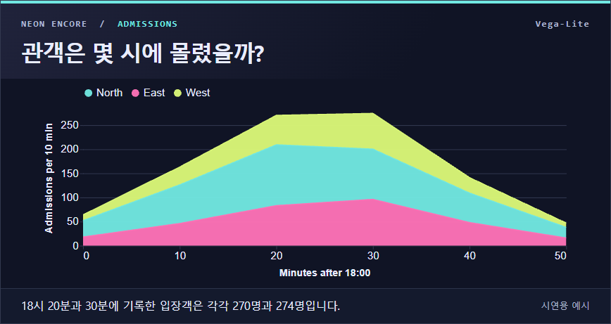

세 색은 북·동·서쪽 출입구입니다. 각 시각에 해당하는 10분간 입장객 수를 쌓으면 세 구역 전체의 혼잡 시간대가 드러납니다. 시각 사이의 선은 기록점을 연결합니다. [렌더링 코드](../examples/data/python_charts.py)

### ggplot2 · 입구별로 관객은 얼마나 기다렸을까?

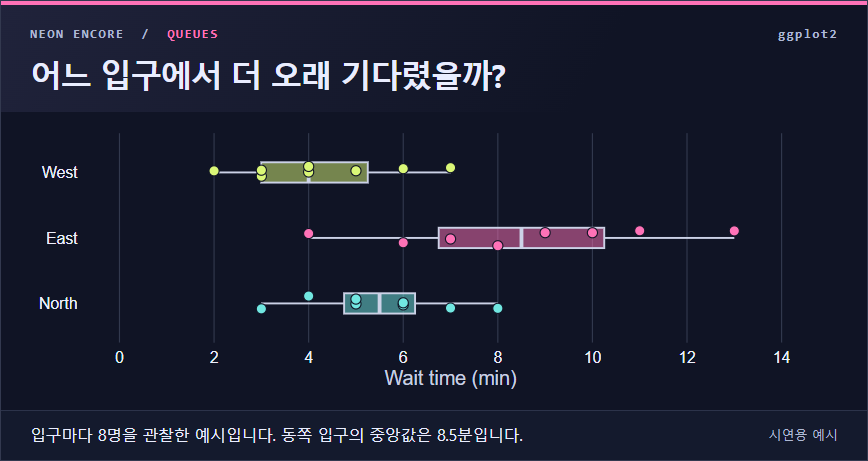

점 하나가 한 사람입니다. 각 입구에서 8명씩 조사했을 때 중앙값은 북쪽 5.5분, 동쪽 8.5분, 서쪽 4분입니다. [R 예제](../examples/data/ggplot.R)

### Apache ECharts · 세 입구를 통과한 사람들은 어디로 갔을까?

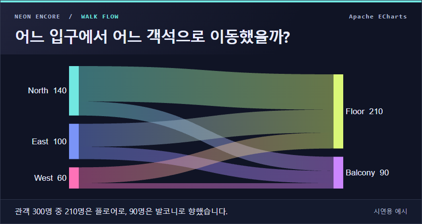

선의 폭은 이동한 사람 수입니다. 별도로 집계한 300명의 동선 중 플로어가 210명, 발코니가 90명입니다. [웹 엔진 예제](../examples/data/charts.js)

### Leaflet · 집결점에서 무대까지 어느 방향으로 움직일까?

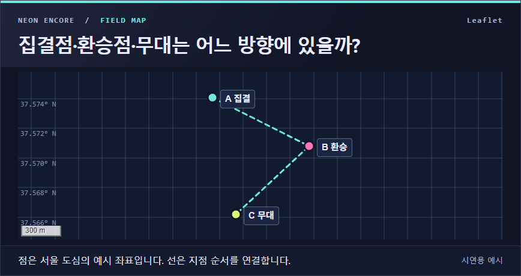

실제 위도·경도 위에 가상의 세 지점을 배치했습니다. A는 37.5741°N, 126.9754°E, B는 37.5708°N, 126.9836°E, C는 37.5662°N, 126.9774°E입니다. 점선은 방문 순서이며, 아래 거리 막대는 Leaflet이 현재 축척에서 계산한 값입니다. 지도 타일 없이도 좌표 위치와 방향을 읽을 수 있습니다. [지도 코드](../examples/data/charts.js)

## 공연이 시작되면

### Altair · 사운드체크 계획은 어디서 어긋났을까?

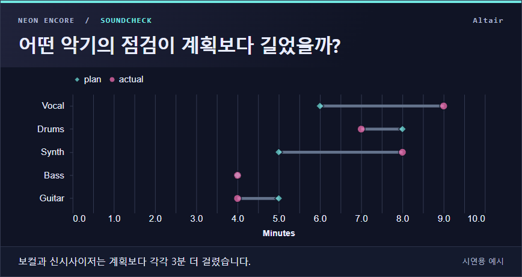

마름모가 계획 시간, 원이 실제 소요 시간입니다. 베이스는 두 값이 4분으로 같아 두 점이 겹칩니다. [Altair 예제](../examples/data/python_charts.py)

### Matplotlib · 두 조명의 밝은 방향은 어디일까?

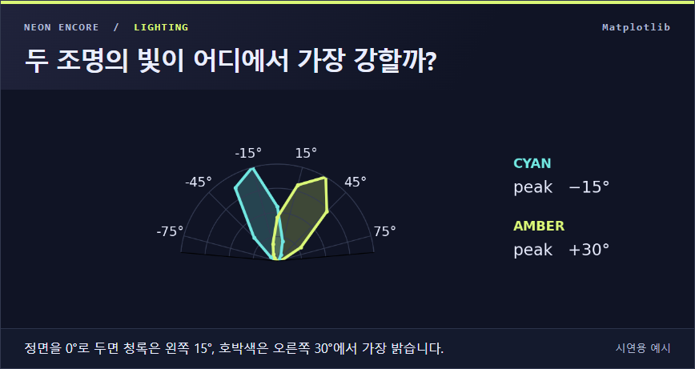

정면을 기준으로 방향을 바꾸며 기록한 상대 밝기입니다. 각 조명의 최고 밝기를 각각 100으로 두었습니다. 중심에서 멀수록 그 방향으로 더 밝습니다. [극좌표 예제](../examples/data/python_charts.py)

### D3 · 한 박씩 돌려 보면 어떤 조명이 켜질까?

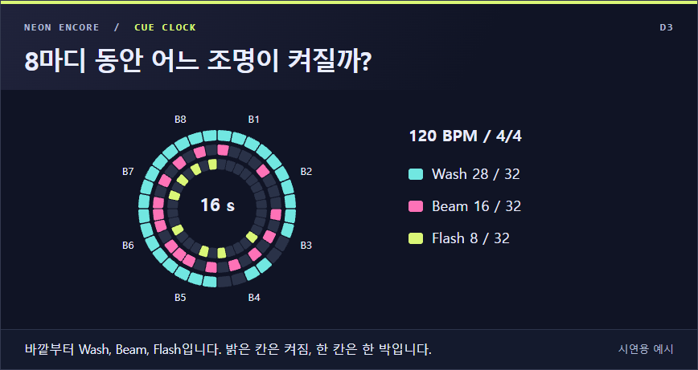

12시에서 시계 방향으로 읽습니다. 4/4박자 8마디는 32박이고, 분당 120박이면 한 바퀴에 16초입니다. 밝은 칸과 오른쪽 숫자가 각 채널의 켜진 박을 나타냅니다. [원형 큐 코드](../examples/data/charts.js)

### Cytoscape.js · 보컬 소리가 녹음기까지 가는 길은?

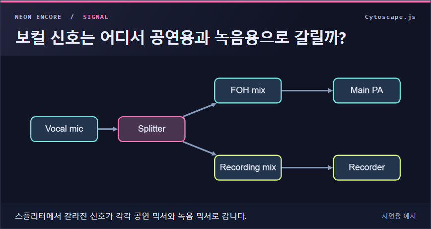

마이크 한 대의 신호가 스플리터에서 두 갈래로 나뉩니다. 위쪽 믹서는 객석용 스피커로, 아래쪽 믹서는 녹음기로 신호를 보냅니다. [연결망 코드](../examples/data/charts.js)

## 앙코르 뒤에 남는 숫자

### seaborn · 어느 곡에서 객석 전체가 함께 반응했을까?

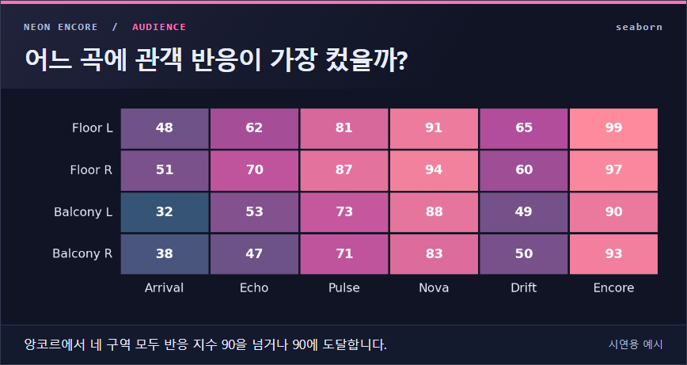

반응을 0~100으로 점수화한 예시입니다. 앙코르의 네 구역 값은 99, 97, 90, 93입니다. 한 구역의 값만 높았던 경우와 여러 구역이 함께 높았던 경우를 같은 표에서 구별할 수 있습니다. [히트맵 코드](../examples/data/python_charts.py)

### Chart.js · 무엇이 전기를 가장 많이 썼을까?

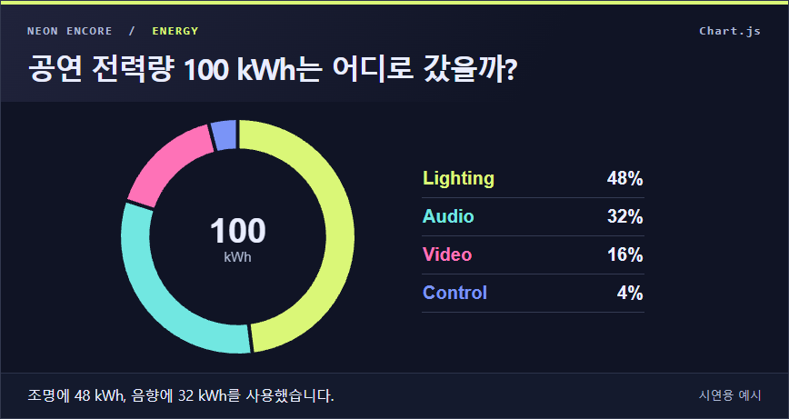

총량이 100 kWh인 예시여서 각 조각의 kWh 숫자와 백분율이 일치합니다. 가장 큰 두 항목인 조명과 음향을 합하면 80 kWh입니다. [도넛 차트 코드](../examples/data/charts.js)

### Observable Plot · 가장 잘 팔린 기념품은?

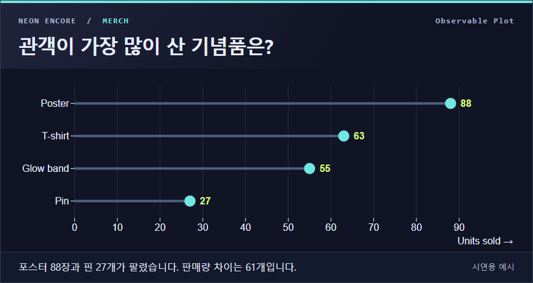

모든 선이 판매량 0에서 시작합니다. 원 옆에 수량을 직접 붙여서 눈금 사이를 짐작할 필요가 없습니다. [순위 그림 코드](../examples/data/charts.js)

### Plotly · 좌석 증감이 최종 판매 수를 어떻게 바꿨을까?

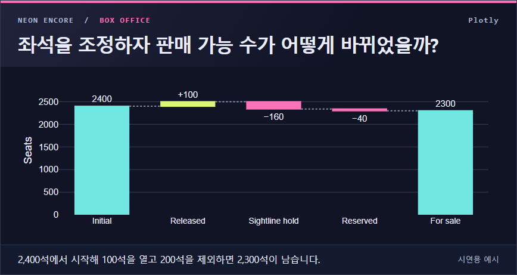

처음과 마지막 막대는 좌석 총수입니다. 중간 막대는 각각 좌석을 여는 작업과 제외한 작업의 증감량입니다. [폭포 차트 코드](../examples/data/charts.js)
