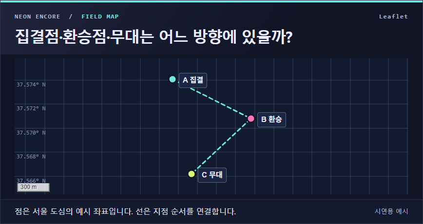
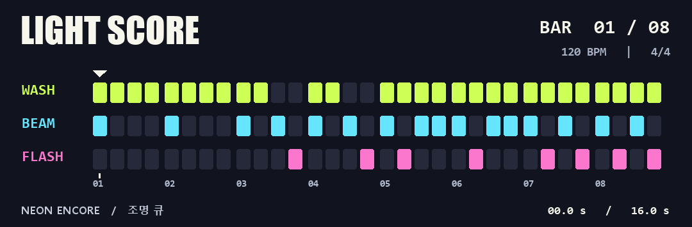

# NEON ENCORE · GitHub 문서 표현 6종

셔틀을 어디서 갈아탈까? 조명은 언제 켜질까? 가상 공연 **NEON ENCORE**의 관객 안내와 리허설 노트를 GitHub 마크다운으로 작성했습니다. 예시의 상대 경로는 이 문서가 있는 `docs/` 폴더를 기준으로 합니다.

[README로 돌아가기](../README.md) · [공연 입력 데이터](../examples/data/show.json)

## GeoJSON 지도 · 셔틀은 어디서 갈아탈까?

서울 도심에 설정한 **가상 경유지**입니다. A 집결점에서 동남쪽으로 이동해 B에서 환승하고, 다시 서남쪽의 C 무대로 갑니다. GitHub에서는 아래 지도를 확대하거나 지점을 눌러 이름을 확인할 수 있습니다.

```geojson
{
  "type": "FeatureCollection",
  "features": [
    {
      "type": "Feature",
      "properties": {"title": "A · 집결", "marker-color": "#27aaa6"},
      "geometry": {"type": "Point", "coordinates": [126.9754, 37.5741]}
    },
    {
      "type": "Feature",
      "properties": {"title": "B · 환승", "marker-color": "#d33b90"},
      "geometry": {"type": "Point", "coordinates": [126.9836, 37.5708]}
    },
    {
      "type": "Feature",
      "properties": {"title": "C · 무대", "marker-color": "#799326"},
      "geometry": {"type": "Point", "coordinates": [126.9774, 37.5662]}
    },
    {
      "type": "Feature",
      "properties": {"title": "방문 순서 A → B → C", "stroke": "#228582"},
      "geometry": {
        "type": "LineString",
        "coordinates": [[126.9754, 37.5741], [126.9836, 37.5708], [126.9774, 37.5662]]
      }
    }
  ]
}
```

**정지 지도**에도 같은 세 지점과 방문 순서를 표시했습니다. 인쇄하거나 오프라인에서 읽을 때는 점선을 따라가세요.



[GitHub에서 GeoJSON 파일 열기](art/elements/shuttle.geojson) · [지도 블록 문법](https://docs.github.com/en/get-started/writing-on-github/working-with-advanced-formatting/creating-diagrams#creating-geojson-and-topojson-maps)

<details>
<summary>집결점 하나로 지도 문법 복사하기</summary>

````markdown
```geojson
{
  "type": "Feature",
  "properties": {"title": "A · 집결"},
  "geometry": {"type": "Point", "coordinates": [126.9754, 37.5741]}
}
```
````

좌표 순서는 `[경도, 위도]`입니다. 세 지점과 연결선을 모두 사용하려면 위에 링크한 GeoJSON 파일의 내용을 블록에 붙여 넣으세요.

</details>

## 배지 · 오늘의 템포는?

[](../examples/data/show.json)

조명 큐를 맞출 때마다 찾는 숫자를 배지에 적었습니다. 배지를 누르면 근거가 되는 입력 파일이 열립니다. `cues.tempo`가 바뀌면 저장소에 담은 SVG의 숫자와 대체 텍스트도 함께 고칩니다.

```markdown
[](../examples/data/show.json)
```

## 이모지 · 안내문에서 내 할 일 찾기

| 안내 | 할 일 |
|---|---|
| 📍 집결 | A에서 셔틀에 탑승합니다. |
| 🔁 환승 | B에서 셔틀을 갈아탑니다. |
| 🎵 리허설 | C 무대에서 첫 박을 셉니다. |

아이콘 옆에 동작을 적어 흑백 인쇄에서도 안내를 읽을 수 있습니다. 표 밖에서도 같은 표기를 쓸 수 있습니다.

```markdown
📍 집결 A → 🔁 환승 B → 🎵 리허설 C
```

## GIF · 다음 조명은 몇 번째 박에 켜질까?

<picture>
  <source media="(prefers-reduced-motion: reduce)" srcset="art/cue-player.png">
  
</picture>

흰 표시가 가리키는 세 칸을 위에서 아래로 읽으세요. 첫 박에는 Wash와 Beam이 함께 켜지고, Flash가 처음 켜지는 때는 세 번째 마디의 네 번째 박입니다. 120 BPM으로 여덟 마디를 재생하면 16초입니다. [정지 화면 열기](art/cue-player.png) · [GIF 열기](art/cue-player.gif) · [제작 코드](../examples/cue_player.py)

<details>
<summary>동작 줄이기 설정에 맞춰 정지 화면을 보여 주는 문법 복사하기</summary>

```html
<picture>
  <source media="(prefers-reduced-motion: reduce)" srcset="art/cue-player.png">
  
</picture>
```

</details>

## 디렉터리 트리 · 지도 원본은 어디에 있을까?

이 문서에서 사용하는 `docs/` 파일만 펼쳤습니다. 셔틀 좌표는 `elements/shuttle.geojson`에, 셔틀의 정지 지도는 `data/leaflet.png`에 있습니다. 두 폴더 모두 `art/` 아래에 있습니다.

```text
docs/
├── github-elements.md
└── art/
    ├── cue-player.gif
    ├── cue-player.png
    ├── data/
    │   └── leaflet.png
    └── elements/
        ├── shuttle.geojson
        └── tempo.svg
```

<details>
<summary>들여쓰기를 보존하는 트리 문법 복사하기</summary>

````markdown
```text
docs/
├── github-elements.md
└── art/
    └── elements/
        └── shuttle.geojson
```
````

</details>

## 알림 블록 · 공연 노트에서 무엇을 강조할까?

자료의 배경, 읽는 요령, 필수 규칙, 즉시 확인할 항목, 수정에 따른 영향을 다섯 가지 GitHub 알림으로 표시할 수 있습니다.

> [!NOTE]
> 셔틀의 세 정류장은 서울 도심 좌표에 배치한 가상 지점입니다.

> [!TIP]
> 지도에서 A·B·C의 위치를 확인한 뒤, 정지 지도에서 세 지점의 이름을 한눈에 볼 수 있습니다.

> [!IMPORTANT]
> GeoJSON의 좌표 쌍에는 경도를 먼저, 위도를 두 번째에 넣습니다.

> [!WARNING]
> 이 파일의 선은 방문 순서를 잇는 직선입니다. 실제 셔틀 안내에 쓰려면 운행 도로와 승하차 위치를 먼저 확인하세요.

> [!CAUTION]
> 예제 GIF와 PNG는 같은 32박을 담고 있습니다. 박자 배열을 바꾸고 GIF만 교체하면 두 그림이 서로 다른 큐를 보여 줍니다.

<details>
<summary>알림 다섯 가지의 마크다운 복사하기</summary>

```markdown
> [!NOTE]
> 셔틀의 세 정류장은 서울 도심 좌표에 배치한 가상 지점입니다.

> [!TIP]
> 지도에서 A·B·C의 위치를 확인한 뒤, 정지 지도에서 세 지점의 이름을 한눈에 볼 수 있습니다.

> [!IMPORTANT]
> GeoJSON의 좌표 쌍에는 경도를 먼저, 위도를 두 번째에 넣습니다.

> [!WARNING]
> 이 파일의 선은 방문 순서를 잇는 직선입니다. 실제 셔틀 안내에 쓰려면 운행 도로와 승하차 위치를 먼저 확인하세요.

> [!CAUTION]
> 예제 GIF와 PNG는 같은 32박을 담고 있습니다. 박자 배열을 바꾸고 GIF만 교체하면 두 그림이 서로 다른 큐를 보여 줍니다.
```

</details>

[GitHub 알림 문법](https://docs.github.com/en/get-started/writing-on-github/getting-started-with-writing-and-formatting-on-github/basic-writing-and-formatting-syntax#alerts)
