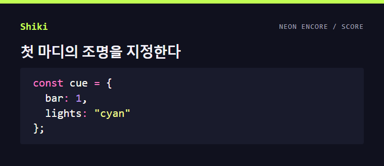
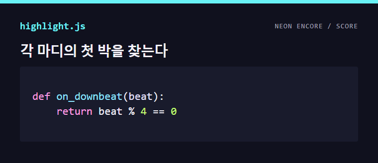
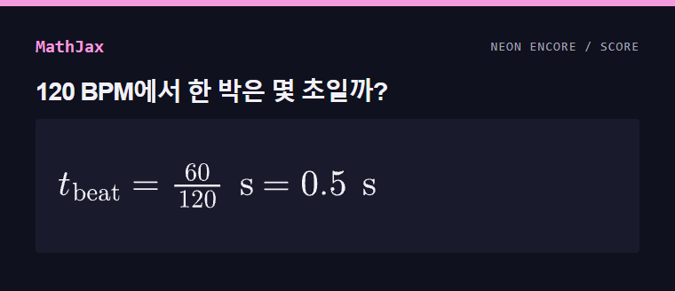
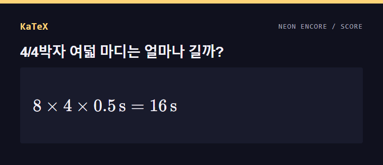

# 공연 기술 노트의 코드와 수식

가상 공연 **NEON ENCORE**의 첫 여덟 마디를 준비한다. 템포는 120 BPM, 박자는 4/4다. Shiki와 highlight.js는 서로 다른 코드에 색을 입히고, MathJax와 KaTeX는 박자와 시간 사이의 계산을 보여 준다. 모든 입력은 이 도감을 위한 시연용 예시다.

## 첫 조명은 무슨 색일까? · Shiki



`bar`는 사람이 읽는 마디 번호다. 첫 마디에 청록 조명을 켠다는 지시를 코드로 옮겼다.

```js
const cue = {
  bar: 1,
  lights: "cyan"
};
```

## 어느 박에서 조명을 바꿀까? · highlight.js



프로그램이 세는 박 번호는 0부터 시작한다. 0, 4, 8처럼 네 박마다 마디가 새로 시작한다.

```python
def on_downbeat(beat):
    return beat % 4 == 0
```

## 한 박의 길이는? · MathJax



120 BPM이면 1분 동안 120번 박이 울린다. **한 박은 60 ÷ 120 = 0.5초**다.

## 다음 큐까지 몇 초를 셀까? · KaTeX



같은 템포가 여덟 마디 내내 유지되면 **8 × 4 × 0.5초 = 16초** 뒤에 다음 큐가 시작된다.

## 내 입력으로 다시 그리기

`examples/notation` 폴더에서 아래 명령을 실행한 뒤 `output`의 HTML 파일을 브라우저로 연다. 실행기는 두 코드 블록에서 강조 태그를 벗긴 텍스트가 원본과 일치하는지 검사한다. MathJax의 분수와 KaTeX의 MathML 결과도 검사한다. [네 예제의 소스](../examples/notation/build.mjs)

```sh
npm install
npm run build
```

[메인 README로 돌아가기](../README.md)
