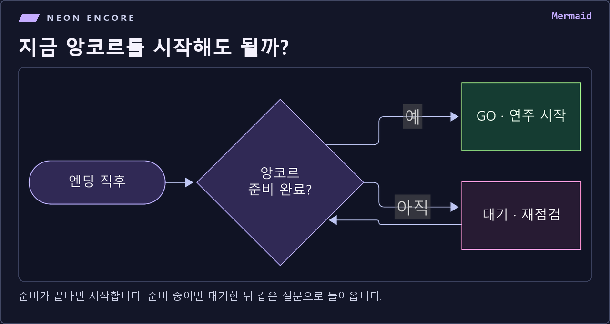
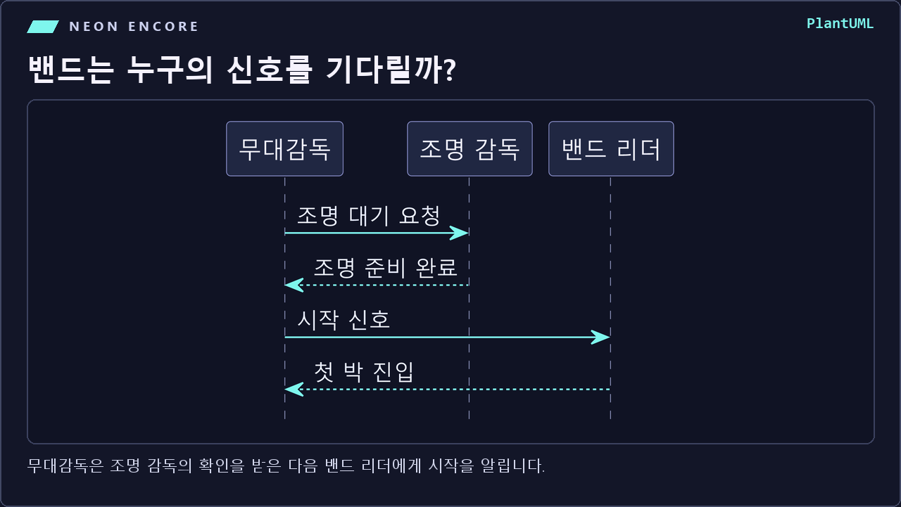
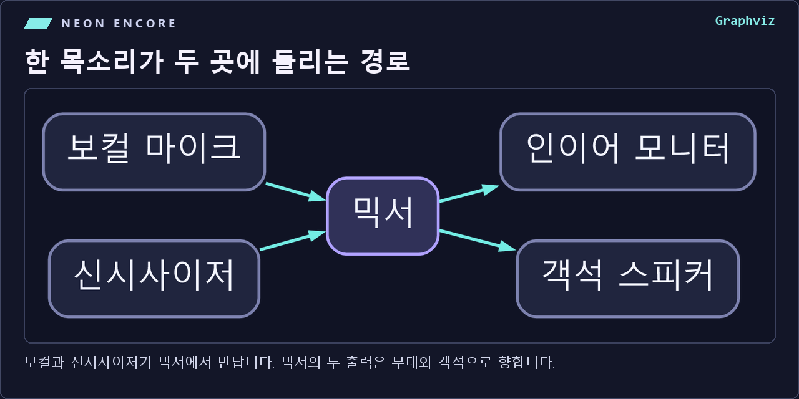
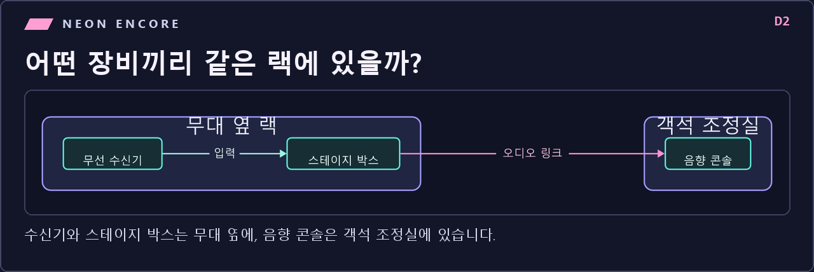
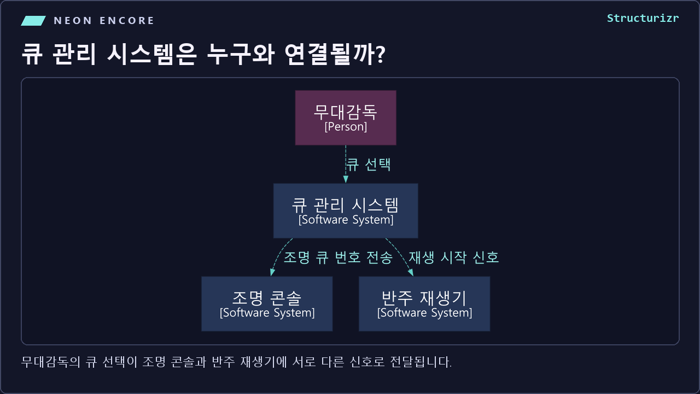
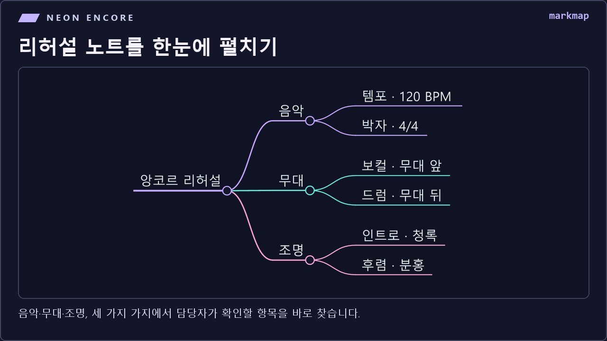
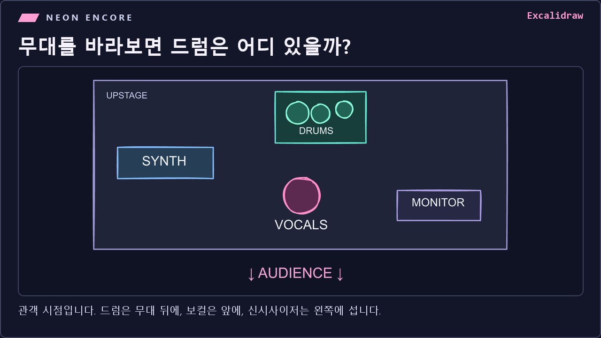
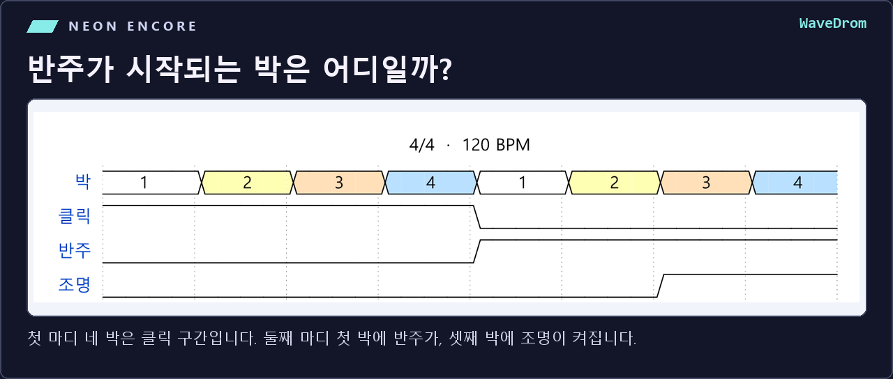
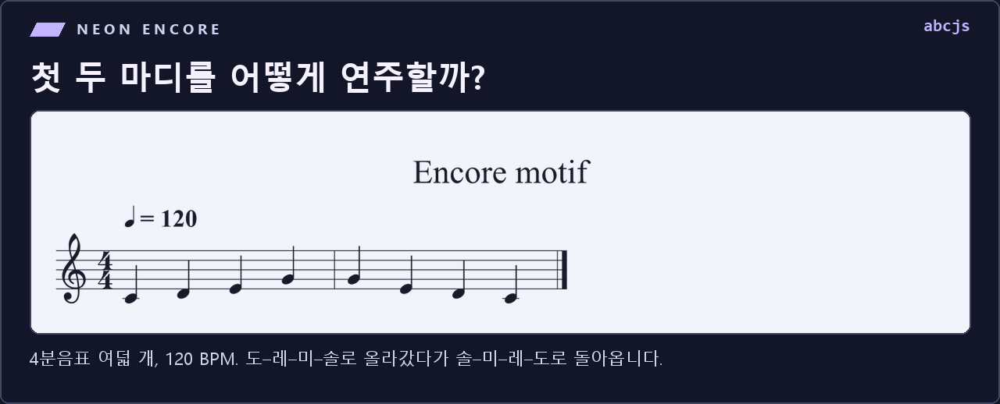

# NEON ENCORE · 무대 뒤의 아홉 장면

마지막 곡이 끝났습니다. 객석에서는 앙코르를 외치고, 무대감독은 조명 감독의 응답을 기다립니다. 같은 공연을 아홉 사람이 각자의 자리에서 바라본다면 어떤 그림이 필요할까요?

이 공연의 인물, 신호, 악곡은 **시연용 예시**입니다. 각 그림 아래에서 입력 파일을 열 수 있습니다. [README로 돌아가기](../README.md)

### 시작 판단 · Mermaid

준비가 늦어졌을 때는 화살표를 따라가 보세요. 같은 조건을 다시 확인하는 지점이 보입니다. [흐름도 원본](../examples/structure/cue-gate.mmd)

### 호출과 응답 · PlantUML

위에서 아래로 읽으면 누가 먼저 말했고 누가 답했는지 알 수 있습니다. 밴드는 무대감독의 세 번째 메시지를 기다립니다. [대화 순서 원본](../examples/structure/standby.puml)

### 소리의 갈림길 · Graphviz

보컬의 목소리는 믹서에서 두 갈래로 나갑니다. 왼쪽에서는 무슨 소리가 들어오는지, 오른쪽에서는 누가 듣는지 따라갈 수 있습니다. [연결 관계 원본](../examples/structure/signal-path.dot)

### 장비의 위치 · D2

큰 상자가 장비의 위치를 표시합니다. 두 상자 사이를 지나는 선은 무대 옆과 객석 조정실을 잇는 오디오 링크입니다. [장비 배치 원본](../examples/structure/patch-bays.d2)

### 시스템의 경계 · Structurizr

같은 ‘시작’이라도 조명 콘솔은 큐 번호를, 반주 재생기는 재생 신호를 받습니다. Structurizr의 시스템 컨텍스트 뷰를 DOT로 내보낸 뒤 Graphviz로 그렸습니다. [C4 모델 원본](../examples/structure/cue-desk.dsl)

### 노트의 가지 · markmap

메모의 제목과 목록이 곧 그림의 가지가 됩니다. ‘조명’에서 출발해 보면 인트로와 후렴에 각각 쓸 색이 보입니다. [마크다운 원본](../examples/structure/set-notes.md)

### 관객이 보는 무대 · Excalidraw

아래쪽이 객석입니다. 보컬이 드럼 앞으로 나오고 신시사이저가 관객의 왼쪽에 오도록 요소의 좌표를 직접 정했습니다. [도형과 좌표 원본](../examples/structure/stage-plot.js)

### 박자에 맞춘 스위치 · WaveDrom

가로 한 칸은 4분음표 한 박입니다. 신호가 높아지는 칸을 찾으면 반주 시작과 조명 켜짐이 두 박 떨어져 있음을 읽을 수 있습니다. [박별 신호 원본](../examples/structure/count-in.json)

### 첫 멜로디 · abcjs

그림 속 여덟 음은 모두 4분음표입니다. 120 BPM에서 한 박은 0.5초이므로, 이 두 마디를 한 번 연주하면 4초가 걸립니다. [ABC 기보 원본](../examples/structure/encore.abc)

같은 입력을 다시 렌더링하는 방법

세 그림을 직접 실행하려면 [로컬 렌더링 예제](../examples/structure/README.md)를 여세요. 무대의 좌표, 리허설 메모, 음표를 바꾼 뒤 결과를 볼 수 있습니다.

| 입력 | 이 도감에 사용한 렌더링 경로 |
|---|---|
| 흐름도 · 순서도 | Mermaid의 `mermaid.render()`와 PlantUML의 `-tsvg`가 각각 SVG를 만듭니다. |
| 소리 경로 · 랙 · 시스템 경계 | Graphviz의 `dot -Tsvg`, D2의 `d2 입력.d2 출력.svg`, Structurizr CLI의 `export -format dot` 다음 `dot -Tsvg`를 사용합니다. |
| 리허설 노트 | `markmap-lib`의 `Transformer.transform()`으로 제목 트리를 읽고 `markmap-view`의 `Markmap.create()`로 그립니다. |
| 무대 배치 | 예제의 `encoreStage()` 결과를 Excalidraw의 `convertToExcalidrawElements()`와 `exportToSvg()`에 차례로 전달합니다. |
| 타이밍 · 악보 | WaveDrom의 `renderAny()`에 JSON을 입력하고, abcjs의 `renderAbc()`에 ABC 기보 문자열을 입력합니다. |

GitHub용 그림은 SVG에 글꼴과 선 색을 적용해 PNG로 내보내고, 제목과 한국어 설명을 붙였습니다.

