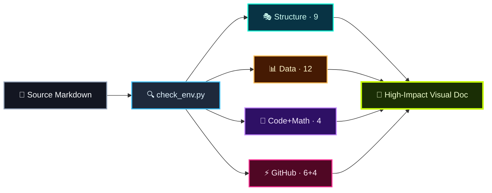

# ⚡ 고자극 GitHub Markdown 표현 패턴집 (`6+4`종)

공연 리허설은 시연용 예시다. README 배지와 디렉터리 트리는 `md-viz` 저장소의 실제 파일을 사용한다. 다른 문서에 옮길 때는 반드시 대상 저장소의 실제 이름·값·경로로 교체한다.

---

## 1. 🗺️ 인터랙티브 지리 지도 (`geojson`)

GitHub에서 아래 블록은 클릭·확대 가능한 라이브 지도로 렌더링된다. 좌표 순서는 반드시 `[경도, 위도]`다. `marker-color`와 `stroke`에 고대비 네온 색을 넣고, 오프라인·인쇄용 정지 지도나 좌표표를 나란히 둔다.

````markdown
📍 집결 지점 A는 동경 `126.9754°`, 북위 `37.5741°`에 있다(시연용 좌표).

```geojson
{
  "type": "FeatureCollection",
  "features": [
    {
      "type": "Feature",
      "properties": {"title": "A · 집결", "marker-color": "#27aaa6"},
      "geometry": {"type": "Point", "coordinates": [126.9754, 37.5741]}
    },
    {
      "type": "Feature",
      "properties": {"title": "B · 환승", "marker-color": "#d33b90"},
      "geometry": {"type": "Point", "coordinates": [126.9836, 37.5708]}
    }
  ]
}
```
````

[GitHub 지도 구문 공식 문서](https://docs.github.com/en/get-started/writing-on-github/working-with-advanced-formatting/creating-diagrams#creating-geojson-and-topojson-maps)

---

## 2. 🏷️ 다중 줄 네온 SVG 배지 월 (`scripts/badge.py`)

`H1` 제목 바로 아래에 `<div align="center">` 여러 줄로 2톤 직사각형 SVG 배지를 촘촘히 배치한다. 각 배지는 반드시 근거 파일·앵커·워크플로에 연결한다.

```html
<div align="center">
  <a href="plugins/md-viz/plugin.json"></a>
  <a href="LICENSE"></a>
  <a href="#25-tool-visual-gallery"></a>
  <a href="docs/github-elements.md"></a>
</div>
```

스킬 폴더에서 표준 라이브러리 전용 [배지 생성기](../scripts/badge.py)로 28px SVG 배지를 즉시 생성한다(배경 휘도 WCAG 자동 대비, 6자리 hex 엄격 검증, XML 이스케이프):

```sh
python scripts/badge.py GALLERY "25 TOOLS" data-tools.svg --color "#C8EF51"
python scripts/badge.py TEMPO "120 BPM" tempo.svg --color "#C8FF00" --label-bg "#23273a"
```

---

## 3. ⚡ 고밀도 시맨틱 이모지 리듬

절 제목, 설치 단계, 표 행, 상태 목록에 의미가 통일된 이모지를 붙이고 항상 텍스트 레이블과 짝지운다.

```markdown
- ✅ **완료** — 로컬 렌더러 25종 사전 점검 (`check_env.py`)
- 🔥 **핵심** — 고대비 다크-네온 멀티컬럼 갤러리 전면 배치
- ⚠️ **주의** — 외부 렌더러 미설치 시 대체 경로 기록
```

---

## 4. 🎬 루프 애니메이션 GIF + `prefers-reduced-motion` PNG

움직임으로 시선을 즉각 사로잡되, 동작 줄이기 설정 사용자를 위해 동일 해상도 정지 PNG를 `<picture>`로 짝지운다.

```html
<picture>
  <source media="(prefers-reduced-motion: reduce)" srcset="docs/art/cue-player.png">
  
</picture>
```

---

## 5. 🗂️ 열 정렬 역할 주석 디렉터리 트리

실제 파일·폴더만 포함하고 동아시아 전각 폭 기준으로 `←` 화살표 열을 칼같이 맞춘다.

````markdown
```text
.                           ← 저장소 루트
├── examples/               ← 공연 예제의 입력과 코드
│   ├── data/               ← 공연 데이터
│   │   └── show.json       ← 조명 큐와 템포의 원본
│   └── cue_player.py       ← 조명 큐 애니메이션 생성
└── docs/                   ← 시각화 도감
    └── art/                ← 도감에 쓰는 그림
        ├── cue-player.gif  ← 재생 중인 조명 큐
        └── cue-player.png  ← 첫 박의 정지 화면
```
````

---

## 6. 📣 GitHub 알림 5종 전량 (`5/5`)

문서 전체에서 다섯 유형 모두 근거 있는 위치를 찾아 배치한다.

```markdown
> [!NOTE]
> 배경 맥락이나 시연용 예시 범위를 밝힙니다.

> [!TIP]
> 실행 시간을 줄이거나 결과를 극대화하는 실전 요령을 알려 줍니다.

> [!IMPORTANT]
> 성공을 위해 반드시 먼저 갖춰야 할 전제 조건을 명시합니다.

> [!WARNING]
> 좌표 순서 오류처럼 미리 피할 수 있는 흔한 함정을 경고합니다.

> [!CAUTION]
> 파일 덮어쓰기나 비가역 손실 위험을 실행 전에 차단합니다.
```

[GitHub 알림 문법 공식 문서](https://docs.github.com/en/get-started/writing-on-github/getting-started-with-writing-and-formatting-on-github/basic-writing-and-formatting-syntax#alerts)

---

## 7. 🌊 네이티브 부스터 · 라이브 네온 스타일 Mermaid

GitHub에서 즉시 렌더링되는 `mermaid` 코드 블록에 고대비 `classDef`를 입혀 시각 임팩트를 극대화한다.

````markdown

````

---

## 8. 🧮 네이티브 부스터 · 라이브 LaTeX 수식 (`$$...$$`)

렌더링된 KaTeX/MathJax 카드 옆에 GitHub 네이티브 수식을 짝지워 복사성과 시각적 강렬함을 동시에 확보한다.

```markdown
$$\Delta t_{\text{beat}} = \frac{60}{120\text{ BPM}} = 0.5\text{ s}, \qquad T_{8\text{ bars}} = 8 \times 4 \times 0.5\text{ s} = 16\text{ s}$$
```

---

## 9. 🖼️ 네이티브 부스터 · 멀티컬럼 인라인 갤러리 월 (`<details open>`)

모든 시각화 결과를 페이지 안에서 바로 조망할 수 있게 3열 그리드 + `<details open>`으로 배치한다.

```markdown
<details open>
<summary><strong>🎭 Structure & Signals · 9 Engines</strong></summary>

| 🔀 Mermaid | 💬 PlantUML | 🕸️ Graphviz |
|:---:|:---:|:---:|
| [](docs/structure.md#시작-판단--mermaid) | [](docs/structure.md#호출과-응답--plantuml) | [](docs/structure.md#소리의-갈림길--graphviz) |

</details>
```

---

## 10. ⌨️ 네이티브 부스터 · `<kbd>` 키캡 프롬프트 필

```markdown
<kbd>/md-viz</kbd> + <kbd>25 Engines</kbd> + <kbd>6+4 Patterns</kbd> → **Full-Throttle Visual Overdrive**
```
