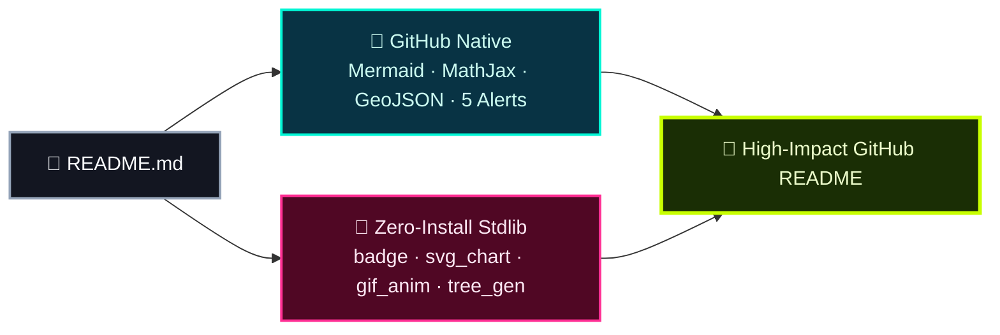

# ⚡ 무설치 GitHub README.md 표현 패턴집 (네이티브 + Stdlib 생성기 4종)

외부 패키지 설치 없이 **GitHub 네이티브 문법**과 **번들 Python 3 표준 라이브러리 생성기 4종**만으로 바로 복사·실행할 수 있는 완성 레시피다. 다른 저장소에 옮길 때는 반드시 대상 저장소의 실제 이름·수치·경로로 교체한다.

---

## 1. 🌊 GitHub 네이티브 · 라이브 네온 `mermaid` 블록

GitHub `README.md`에서 별도 이미지 변환 없이 즉시 벡터로 렌더링된다.

````markdown

````

---

## 2. 🧮 GitHub 네이티브 · 라이브 `MathJax` 수식

GitHub 공식 내장 수식 엔진은 **MathJax**다. 인라인 `$...$`, 블록 `$$...$$`, 또는 ` ```math ` 펜스를 그대로 쓴다.

```markdown
$$\Delta t_{\text{beat}} = \frac{60}{120\text{ BPM}} = 0.5\text{ s}, \qquad T_{8\text{ bars}} = 8 \times 4 \times 0.5\text{ s} = 16\text{ s}$$
```

---

## 3. 🗺️ GitHub 네이티브 · 라이브 인터랙티브 `geojson` 지도

좌표 순서는 반드시 `[경도, 위도]`다.

````markdown
```geojson
{
  "type": "FeatureCollection",
  "features": [
    {
      "type": "Feature",
      "properties": {"title": "A · 집결", "marker-color": "#27aaa6"},
      "geometry": {"type": "Point", "coordinates": [126.9754, 37.5741]}
    },
    {
      "type": "Feature",
      "properties": {"title": "B · 환승", "marker-color": "#d33b90"},
      "geometry": {"type": "Point", "coordinates": [126.9836, 37.5708]}
    }
  ]
}
```
````

[GitHub 지도 구문 공식 문서](https://docs.github.com/en/get-started/writing-on-github/working-with-advanced-formatting/creating-diagrams#creating-geojson-and-topojson-maps)

---

## 4. 📣 GitHub 네이티브 · 알림 5종 전량 (`5/5`)

```markdown
> [!NOTE]
> 배경 맥락이나 시연용 예시 범위를 밝힙니다.

> [!TIP]
> 실행 시간을 줄이거나 결과를 극대화하는 실전 요령을 알려 줍니다.

> [!IMPORTANT]
> 성공을 위해 반드시 먼저 갖춰야 할 전제 조건을 명시합니다.

> [!WARNING]
> 좌표 순서 오류처럼 미리 피할 수 있는 흔한 함정을 경고합니다.

> [!CAUTION]
> 파일 덮어쓰기나 비가역 손실 위험을 실행 전에 차단합니다.
```

[GitHub 알림 문법 공식 문서](https://docs.github.com/en/get-started/writing-on-github/getting-started-with-writing-and-formatting-on-github/basic-writing-and-formatting-syntax#alerts)

---

## 5. 🏷️ 무설치 stdlib · 다중 줄 네온 SVG 배지 월 (`scripts/badge.py`)

```sh
python scripts/badge.py RELEASE "V0.4.0" docs/art/release.svg --color "#2864BA"
python scripts/badge.py ZERO-DEPS "PYTHON STDLIB" docs/art/zero-deps.svg --color "#00F5D4"
```

```html
<div align="center">
  <a href="plugins/md-viz/plugin.json"></a>
  <a href="plugins/md-viz/skills/md-viz/SKILL.md"></a>
</div>
```

---

## 6. 📊 무설치 stdlib · 순수 SVG 차트 10종 (`scripts/svg_chart.py`)

GitHub ``에서 안전하게 렌더링되는 순수 `<svg>`만 출력한다(`<script>`·`<foreignObject>` 0건). 지원 유형: `hero`, `kpi`, `bar`, `line`, `donut`, `heatmap`, `waterfall`, `radar`, `sankey`, `timeline`.

```json
{
  "title": "Zero-Install Visual Stack",
  "subtitle": "KPI STRIP",
  "accent": "#00F5D4",
  "items": [
    {"label": "EXTERNAL DEPS", "value": "0", "delta": "STDLIB", "note": "No npm / pip / browser"},
    {"label": "SVG VISUALS", "value": "10", "delta": "SAFE", "note": "Pure GitHub  SVG"},
    {"label": "GITHUB NATIVE", "value": "6", "delta": "LIVE", "note": "Mermaid · MathJax · GeoJSON"},
    {"label": "ANIMATION", "value": "GIF+PNG", "delta": "A11Y", "note": "Reduced-motion <picture>"}
  ]
}
```

```sh
python scripts/svg_chart.py --type kpi --spec kpi.json --out docs/art/kpi.svg --readme README.md --slot kpi --alt "Zero-install stack KPI strip"
```

---

## 7. 🎬 무설치 stdlib · 루프 GIF89a + 정지 PNG (`scripts/gif_anim.py`)

Pillow 없이 GIF89a 애니메이션과 동일 해상도 PNG를 함께 생성하고 `<picture>` 태그를 삽입한다.

```json
{
  "title": "ZERO-INSTALL PIPELINE LOOP",
  "width": 760,
  "height": 196,
  "steps": 16,
  "duration_ms": 220,
  "tracks": [
    {"label": "NATIVE", "color": "#00F5D4", "active": [0, 1, 2, 3, 8, 9, 10, 11]},
    {"label": "SVG", "color": "#FF2E93", "active": [2, 3, 4, 5, 6, 10, 11, 12, 13]},
    {"label": "GIF", "color": "#C8FF00", "active": [5, 6, 7, 12, 13, 14, 15]}
  ]
}
```

```sh
python scripts/gif_anim.py --spec loop.json --out docs/art/loop.gif --readme README.md --slot loop --alt "Zero-install animated step loop"
```

---

## 8. 🗂️ 무설치 stdlib · 실제 저장소 열 정렬 트리 (`scripts/tree_gen.py`)

실제 파일·폴더만 스캔해 동아시아 전각 폭 기준 단일 열로 `← 역할 설명`을 정렬한다.

```sh
python scripts/tree_gen.py --root . --max-depth 3 --readme README.md --slot repo-tree
```

---

## 9. 🖼️ 멀티컬럼 갤러리 월 (`<details open>`) & `<kbd>` 키캡

```markdown
<details open>
<summary><strong>⚡ Zero-Install Pure-SVG Visual Gallery</strong></summary>

| 📊 KPI Strip | 📈 Trend Line | 🍩 Donut Ring |
|:---:|:---:|:---:|
|  |  |  |

</details>

<kbd>/md-viz</kbd> + <kbd>0 External Installs</kbd> + <kbd>10 Pure-SVG Charts</kbd> + <kbd>Stdlib GIF89a</kbd>
```
